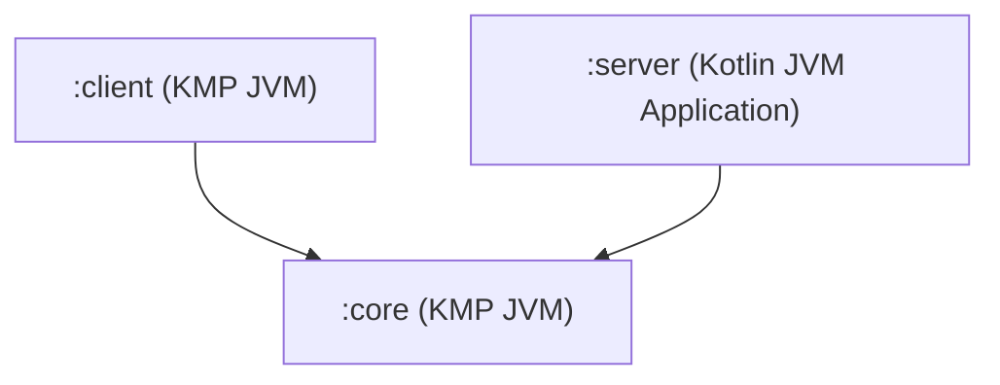

# Agent Operational Guide: vendorlane

This document provides operational context, architectural standards, and coding conventions for AI agents working in the `vendorlane` repository.

---

## 1. Project Overview & Technology Stack

`vendorlane` is a Kotlin Multiplatform (KMP) and Ktor 3.6.0 backend ecosystem targeting the JVM.

### Core Technologies
- **Language**: Kotlin 2.x (`kotlin.code.style=official`)
- **Runtime / Toolchain**: Java 21 (`jvmToolchain(21)`)
- **Web Framework**: Ktor 3.6.0 with Netty engine
- **Dependency Management**: Gradle Kotlin DSL (`build.gradle.kts`, `settings.gradle.kts`) with Version Catalogs:
  - `gradle/libs.versions.toml` (`libs`)
  - Ktor Version Catalog `io.ktor:ktor-version-catalog:3.6.0` (`ktorLibs`)
- **Dependency Injection**: Koin (`koin-ktor`, `koin-logger-slf4j`)
- **Database & Persistence**:
  - JetBrains Exposed 0.61.0 (`exposed-core`, `exposed-r2dbc`)
  - R2DBC for reactive/suspending operations (`r2dbc-h2`, `r2dbc-postgresql`)
  - Standard JDBC drivers for relational access (`postgresql`, `h2`)
- **Observability & Diagnostics**:
  - OpenTelemetry SDK & OTLP gRPC/HTTP exporter
  - Micrometer Prometheus registry (`io.micrometer:micrometer-registry-prometheus`)
  - Cohort health check engine (`com.sksamuel.cohort:cohort-ktor`)
- **Security & Serialization**:
  - `kotlinx.serialization` (JSON)
  - JWT Authentication & Session state management
  - Flaxoos Rate Limiting

---

## 2. Module Layout & Dependency Boundaries

The repository is structured into three multi-project modules:

```
vendorlane/
├── core/       # Shared models, utilities, and common OpenTelemetry initialization
├── client/     # HTTP Client SDK with built-in OpenTelemetry tracing
└── server/     # Primary backend service application (Ktor + Netty)
```

### Module Responsibilities & Dependency Graph


- **`:core`** (`com.puregold.vendorlane`):
  - Shared domain models and shared infrastructure.
  - Multiplatform target JVM (`jvm()`).
  - OpenTelemetry configuration and span/meter provider setup (`OpenTelemetry.kt`).
  - **Constraint**: Must remain agnostic of server logic and routing plugins.
- **`:client`** (`com.puregold.vendorlane`):
  - Multiplatform target JVM (`jvm()`).
  - Outgoing HTTP client configured with Ktor `HttpClient`, ContentNegotiation, and client-side OpenTelemetry tracing.
  - Depends on `:core`.
- **`:server`** (`com.puregold.vendorlane`):
  - Kotlin JVM application (`application` plugin, `mainClass = "com.puregold.vendorlane.MainKt"`).
  - Port 8080 Netty server engine.
  - Depends on `:core`, Ktor server plugins, Exposed, Koin, and Cohort.

---

## 3. Architecture & Code Conventions

### Application Lifecycle & Modularity
The server application entry point is `com.puregold.vendorlane.MainKt` (`server/src/main/kotlin/main.kt`), invoking Netty `EngineMain.main(args)`.

Configuration is decomposed into modular extension functions on `io.ktor.server.application.Application`:
- `Application.rootModule()` in `Application.kt` is the main entry point called by Ktor configuration or tests.
- Extension modules located in `server/src/main/kotlin/`:
  - `configureRouting()` (`Routing.kt`): Declares endpoints, route hierarchies, static assets, and OpenAPI/Swagger routes.
  - `configureKoin()` (`Koin.kt`): Installs Koin DI module and registers service dependencies (e.g., `UsersService`).
  - `configureExposed()` (`Exposed.kt`): Configures Exposed R2DBC database connections and initializes schema tables (e.g., `CitySchema`).
  - `configureSecurity()` (`Security.kt`): Configures JWT authentication, user validation, and session handling.
  - `configureMonitoring()` (`Monitoring.kt`): Configures CallLogging, Dropwizard/Micrometer metrics, and Cohort health checks.
  - `configureStatusPages()` (`StatusPages.kt`): Handles unhandled exceptions and custom status code responses.
  - `configureRateLimiting()` (`RateLimiting.kt`): Configures endpoint call quotas and IP/key based rate limits.
  - `configureSerialization()` (`Serialization.kt`): Configures JSON content negotiation via `kotlinx.serialization`.

### Dependency Injection
- Use Koin for managing injectable dependencies.
- Services should be registered in `configureKoin()` using `single` or `factory`.
- Inject dependencies into routes or handlers using `by inject<Type>()` or `call.scope.get<Type>()`.

### Persistence Guidelines
- Use Exposed R2DBC `suspendTransaction` or `DatabaseClient` for reactive asynchronous queries:
  ```kotlin
  suspendTransaction {
      // Exposed DSL / Schema queries
  }
  ```
- For blocking JDBC operations, always dispatch them to `Dispatchers.IO`:
  ```kotlin
  withContext(Dispatchers.IO) {
      transaction { ... }
  }
  ```

### Code Style & Hygiene
- Strictly adhere to `kotlin.code.style=official`.
- Do not create God-classes or lump multiple route definitions into a single file. Keep routes organized by domain resource.
- Keep data classes immutable (`val`) and declare `@Serializable` where JSON transport is required.

---

## 4. Agent Operational Rules & Guardrails

When working on this repository, AI agents must abide by the following constraints:

1. **Respect Module Boundaries**:
   - Never import `:server` dependencies or packages (`io.ktor.server.*`, `org.jetbrains.exposed.r2dbc.*`) into `:core` or `:client`.
   - Keep `:core` focused on cross-cutting primitives and telemetry contracts.
2. **Preserve Compatibility**:
   - Maintain JDK 21 compatibility. Do not introduce language constructs or bytecode incompatible with Java 21 toolchains.
   - Do not alter Gradle Version Catalog aliases unless explicitly requested.
3. **Transactional Safety**:
   - Never execute blocking database transactions on the Ktor Netty event loop threads without `Dispatchers.IO` or R2DBC suspend transactions.
4. **Integration Test Integrity**:
   - Never mock Ktor server internals when integration tests can be written using `testApplication { ... }`.
   - Never disable or weaken existing tests in `ServerTest.kt` to force builds to pass.

---

## 5. Build & Development Commands

Always execute Gradle commands using the wrapper from the repository root.

### Common Build Commands

| Action | Unix / macOS | Windows PowerShell / CMD |
| :--- | :--- | :--- |
| **Build entire project** | `./gradlew build` | `.\gradlew.bat build` |
| **Compile Kotlin sources** | `./gradlew compileKotlin` | `.\gradlew.bat compileKotlin` |
| **Run Ktor server** | `./gradlew :server:run` | `.\gradlew.bat :server:run` |
| **Run all tests** | `./gradlew test` | `.\gradlew.bat test` |
| **Run server tests only** | `./gradlew :server:test` | `.\gradlew.bat :server:test` |
| **Run client tests only** | `./gradlew :client:test` | `.\gradlew.bat :client:test` |
| **Run core tests only** | `./gradlew :core:test` | `.\gradlew.bat :core:test` |

### Targeted Test Execution
To run a specific test class:
```bash
# Unix
./gradlew :server:test --tests "com.puregold.vendorlane.ServerTest"

# Windows
.\gradlew.bat :server:test --tests "com.puregold.vendorlane.ServerTest"
```

To run a specific test method:
```bash
# Unix
./gradlew :server:test --tests "com.puregold.vendorlane.ServerTest.testRoot"

# Windows
.\gradlew.bat :server:test --tests "com.puregold.vendorlane.ServerTest.testRoot"
```

---

## 6. Testing Patterns & Guidelines

Server integration tests are written using Ktor's `testApplication` harness (`io.ktor.server.testing.*`):

```kotlin
class ServerTest {
    @Test
    fun testRoot() = testApplication {
        application {
            rootModule()
        }
        val response = client.get("/")
        assertEquals(HttpStatusCode.OK, response.status)
        assertEquals("Hello World!", response.bodyAsText())
    }
}
```

### Key Testing Rules
- Always invoke `application { rootModule() }` to ensure all plugins, Koin modules, and routes are wired identically to production.
- Use `client.get(...)` / `client.post(...)` provided by the `testApplication` scope to issue in-memory HTTP requests.
- For persistence tests, prefer using in-memory H2 (`libs.h2database.h2`, `libs.h2database.r2dbc`) rather than requiring external database daemons.
- Verify status codes using `HttpStatusCode` constants (`HttpStatusCode.OK`, `HttpStatusCode.Created`, `HttpStatusCode.NotFound`, etc.).

---

## 7. Development Endpoints & Observability

When running `:server:run`, the application listens on port **8080** by default.

### Key HTTP Endpoints

| Endpoint | Method | Purpose | Source File |
| :--- | :--- | :--- | :--- |
| `/` | `GET` | Smoke test root response ("Hello World!") | `Routing.kt` |
| `/session/increment` | `GET` | Session state counter validation | `Routing.kt` |
| `/static/*` | `GET` | Serves static assets from classpath resources | `Routing.kt` |
| `/openapi` | `GET` | OpenAPI specification endpoint | `Routing.kt` |
| `/swagger` | `GET` | Swagger UI interactive documentation | `Routing.kt` |
| `/metrics-micrometer` | `GET` | Prometheus metrics scrape endpoint | `Monitoring.kt` |
| `/health` | `GET` | Cohort health check actuator | `Monitoring.kt` |
| `/cities` | `POST` | Create a city record in Exposed database | `CitySchema.kt` |
| `/cities/{id}` | `GET` | Fetch city by identifier | `CitySchema.kt` |
| `/cities/{id}` | `PUT` | Update city record | `CitySchema.kt` |
| `/cities/{id}` | `DELETE` | Remove city record | `CitySchema.kt` |

### Observability Stack
- **OpenTelemetry**: Initialized via `:core` (`OpenTelemetry.kt`). Configured with OpenTelemetry SDK, OTLP exporters, and semantic conventions for service attributes.
- **Metrics**: Micrometer with Prometheus meter registry configured in `Monitoring.kt`.
- **Health Checks**: Cohort Ktor plugin configured in `Monitoring.kt` for liveness and readiness probes under `/health`.

---

## 8. AI Agent Pre-Completion Checklist

Before submitting changes or marking tasks as finished, AI agents must complete this validation checklist:

- [ ] **Compilation**: Run `./gradlew compileKotlin` (or `.\gradlew.bat compileKotlin`) to verify error-free compilation.
- [ ] **Tests Passing**: Run `./gradlew test` (or `.\gradlew.bat test`) to ensure all unit and integration tests pass cleanly.
- [ ] **Module Boundaries**: Confirm no server-only dependencies were added to `:core` or `:client`.
- [ ] **Formatting**: Confirm Kotlin code follows official style (`kotlin.code.style=official`).
- [ ] **No Dead Code / Leftovers**: Remove any temporary debugging logs, unused imports, or scratch files.
