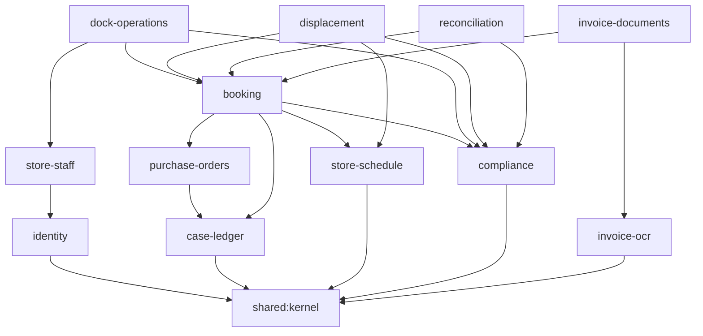

# VendorLane — Backend Module Architecture & Regression Test Strategy

**Kotlin Multiplatform · Multi-module · Clean Architecture · Test-Driven Development · Chained Scenario Regression Suite**

| Field | Detail |
|---|---|
| **Version** | 1.0 (Draft for Review) |
| **Date** | October 2026 |
| **Status** | **Proposed** |
| **Source Specification** | `docs/VendorLane_PRD_v1.0.md` (PRD v1.4) |
| **Document Path** | `docs/VendorLane_Module_Architecture_v1.0.md` |
| **Audience** | Backend engineers, tech lead, QA |
| **Scope** | Phase 1 (Pilot / Soft Launch) backend. Phase 2–3 extension points are marked. |

---

## 1. Purpose & Scope

This document answers five questions about the VendorLane backend:

1. How is the PRD split into Gradle modules?
2. Which modules may depend on which, and how is that enforced?
3. What lives inside each module (use cases, policies, ports, adapters)?
4. How is each business rule built test-first?
5. How do we run **chained scenario tests**: regression suites that chain several use cases into one story, while staying unit tests (no database, no HTTP, no real clock)?

**Out of scope:** Units of Work, tickets and task breakdown (next document), Compose client modules, detailed SQL schemas, infrastructure and deployment.

**Conventions used below**

- References such as `US-04`, `AC-05.3`, `BR-10`, `D40`, `OQ-8` point to PRD sections.
- Kotlin snippets are illustrative sketches of *shape*, not final signatures.
- Items marked **(proposed)** are design choices this document adds; the PRD does not specify them.
- Items marked **O-n** are PRD observations collected in [§11](#11-prd-observations-affecting-module-boundaries).

---

## 2. Architectural Principles

| # | Principle | Consequence |
|---|---|---|
| **P1** | **Feature-first, layer-second.** Modules follow business capabilities (booking, dock operations, reconciliation…), not technical layers. | A feature has one owner; changing it rarely touches other modules. |
| **P2** | **Dependency rule.** Dependencies point inward: `routes`/`data` → `domain` → `kernel`. | `domain` modules compile with no Ktor, Exposed, Koin, GCS, PDFBox or Tess4J on the classpath. |
| **P3** | **One rule, one use case. Use cases are siblings.** A use case never calls or depends on another use case. | Each use case is a unit of change: add, modify or delete it without ripple effects, and its test is its regression net. |
| **P4** | **Shared decisions live in policies and domain services, never in use-case-to-use-case calls.** | When two use cases need the same decision (for example PO selection rules in both "validate selection" and "create booking"), extract a pure *policy* object. Small code duplication between use cases is an accepted trade-off; duplicated *rules* are not. |
| **P5** | **Cross-feature collaboration only through** (a) another feature's domain models, (b) its ports, policies and domain services, or (c) domain events. Never its use cases, `data` or `routes`. | Module graph stays acyclic; orchestration happens in scenario tests (to prove it) and the composition root (to wire it). |
| **P6** | **Inverted read ports.** When an upstream feature needs data owned downstream (booking showing an attachment summary), the upstream declares the read port and the downstream `data` module implements it. | No cycles, no reaching into other features' tables. |
| **P7** | **Outcomes are data.** Use cases return sealed results with domain-named failures (`CaseBalanceExceeded`, `WindowFull`); `routes` map them to HTTP status codes. | Negative paths are ordinary assertions in unit tests. |
| **P8** | **Time, IDs, transactions, audit and events are injected** through `shared:kernel` ports (`Clock`, `IdGenerator`, `TransactionRunner`, `AuditRecorder`, `DomainEventPublisher`). | Every use case is deterministic under test; BR-21 (`Asia/Manila`) is enforced in one place. |
| **P9** | **Tenancy is a domain concern.** Use cases that touch tenant data receive an `Actor` (user, role, `vendor_code` or `store_id`). | Store/supplier isolation (AC-06.4, §4.5) is unit-tested, not only enforced by route interceptors or SQL predicates. |
| **P10** | **JVM-only technology stays in adapters.** PDFBox, Tess4J/Leptonica, GCS, Exposed R2DBC, SMTP, BCrypt, JWT. | `domain` modules stay Kotlin-Multiplatform-clean and fast to test. |
| **P11** | **Create modules when first needed, not up front.** `domain` modules exist from day one; `data` and `routes` modules appear with the first adapter or endpoint. | Keeps Gradle configuration time and cognitive load proportional to delivered scope. |

---

## 3. Module Map

### 3.1 Repository layout

```
vendorlane/
├── build-logic/                         # convention plugins (§9)
├── gradle/libs.versions.toml
├── shared/
│   ├── kernel/                          # KMP: ports and value types shared by every module
│   └── contracts/                       # KMP: @Serializable wire DTOs (HTTP + Compose client)
├── platform/                            # JVM: technical capabilities, zero business rules
│   ├── persistence/                     # Exposed R2DBC setup, TransactionRunner impl, migrations, audit_log writer
│   ├── security/                        # JWT verification, BCrypt, RBAC route interceptors, Actor extraction
│   └── scheduler/                       # background job runner (cron and fixed-delay jobs)
├── features/
│   ├── identity/            { domain, data, routes }
│   ├── store-staff/         { domain, data, routes }
│   ├── purchase-orders/     { domain, data, routes }
│   ├── case-ledger/         { domain }                  # rule + port module; adapter lives in booking:data
│   ├── store-schedule/      { domain, data, routes }
│   ├── booking/             { domain, data, routes }
│   ├── displacement/        { domain, data, routes }
│   ├── dock-operations/     { domain, routes }          # persists via booking, compliance, audit ports
│   ├── compliance/          { domain, data }
│   ├── reconciliation/      { domain, data, routes }
│   ├── invoice-documents/   { domain, data, routes }
│   └── invoice-ocr/         { domain, engines }         # engines = PDFBox + Tess4J adapters
├── app/
│   └── server/                          # composition root: Koin modules, Ktor Application, config, job registration
└── testing/
    ├── fakes/                           # in-memory ports, MutableClock, contract specs
    ├── scenarios/                       # chained scenario regression suite (§8)
    ├── architecture/                    # Konsist guard rules (§4.3)
    └── ocr-benchmark/                   # 100-document evaluation, nightly only (§7)
```

### 3.2 Inside every feature `domain` module

```
features/booking/domain/src/
  commonMain/kotlin/com/puregold/vendorlane/booking/domain/
    model/      # aggregates, value objects, enums (Booking, BookingStatus, WindowSlot…)
    policy/     # pure decision objects (BookingWindowPolicy, OverbookingPolicy…)
    port/       # interfaces to the outside world (BookingRepository, WindowOccupancyRepository…)
    event/      # domain events this feature publishes
    usecase/    # one class per business rule, one public operator fun invoke
  commonTest/kotlin/com/puregold/vendorlane/booking/domain/
    usecase/    # <UseCaseName>Test, one file per use case
    policy/     # <PolicyName>Test
```

Package root: `com.puregold.vendorlane.<feature>.<layer>`.

### 3.3 Targets and source-set policy

| Module kind | Convention plugin | Targets | Rules |
|---|---|---|---|
| `shared:kernel` | `vendorlane.kmp.domain` | `jvm` (add client targets only when the Compose client reuses it) | Stdlib, coroutines-core and datetime only. |
| `shared:contracts` | `vendorlane.kmp.contracts` | `jvm` + client targets | The only module with `kotlinx-serialization`; DTOs only, no logic. |
| `features:*:domain` | `vendorlane.kmp.domain` | `jvm` | `commonMain` is pure Kotlin; Gradle explicit-API mode on. |
| `features:*:data`, `*:routes`, `invoice-ocr:engines`, `platform:*` | `vendorlane.jvm.adapter` | JVM | JVM libraries allowed. |
| `testing:fakes`, `testing:scenarios` | `vendorlane.kmp.testing` | `jvm` | Hand-written fakes in `commonMain`/`commonTest`; MockK only in `jvmTest`. |

### 3.4 Mapping from the PRD

| This document | PRD §4.1 module | Feature PRD (§10.1) | Stories |
|---|---|---|---|
| `identity` | *(Core Authentication / Password Recovery subsystems)* | — | US-09, US-10, US-11, US-12 |
| `store-staff` | `StoreStaffModule` | `store-staff-roster` | US-06 |
| `purchase-orders` | `PoIntegrationModule` | `po-query-and-selection` | US-01 |
| `case-ledger` | `PoAllocationLedgerModule` | `po-query-and-selection`, `arrival-window-booking` | AC-01.6 |
| `store-schedule` | `BookingModule` (part) | `arrival-window-booking` | US-03 (capacity, windows, scenarios) |
| `booking` | `BookingModule` (part) | `arrival-window-booking` | US-03 |
| `displacement` | `BookingModule` (part) | `arrival-window-booking` | BR-16, D37, D38, OQ-8 |
| `dock-operations` | `BookingModule` (part) | `dock-arrival-and-receiving` | US-04, US-07 |
| `compliance` | *(not shown in PRD §4.1)* | `dock-arrival-and-receiving`, `daily-receiving-reconciliation` | §7.1, BR-09, BR-20 |
| `reconciliation` | `ReconciliationModule` | `daily-receiving-reconciliation` | US-08 |
| `invoice-documents` | `DocumentStorageModule` | `dual-engine-invoice-ocr` | US-02, US-05 |
| `invoice-ocr` | Dual-Engine OCR Orchestrator | `dual-engine-invoice-ocr` | US-05, §3 |

---

## 4. Module Dependency Rules

### 4.1 Feature `domain` dependency graph

Every `domain` module also depends on `shared:kernel` (edges omitted except for leaf modules to keep the diagram readable).



Reading the graph: `identity`, `case-ledger`, `store-schedule`, `compliance` and `invoice-ocr` are leaves with no feature dependencies, so they can be built and tested first and in parallel. `booking` is the hub; everything operational hangs off it.

### 4.2 Allowed dependencies by module kind

| Module kind | May depend on | Must not depend on |
|---|---|---|
| `shared:kernel` | Kotlin stdlib, coroutines-core, datetime | anything else |
| `shared:contracts` | kotlinx-serialization | any feature module |
| `*:domain` | `shared:kernel`; upstream `*:domain` per §4.1 | Ktor, Exposed, Koin, SQL drivers, `shared:contracts`, any `data`/`routes`/`engines` |
| `*:data`, `*:engines` | own `domain`; upstream `domain` ports it implements; `platform:persistence`; JVM libraries | other features' `data`, any `routes` |
| `*:routes` | own `domain`; `shared:contracts`; `platform:security`; Ktor server | any `data`; other features' `routes` |
| `platform:*` | `shared:kernel` | any `features:*` |
| `app:server` | everything | — (the only module that sees all modules) |
| `testing:fakes`, `testing:scenarios` | all `*:domain`, `shared:kernel` | `data`, `routes`, Ktor |

Response DTO mapping lives in the `routes` module that returns the DTO. If two `routes` modules return the same DTO (`BookingDto` from both `booking` and `dock-operations`), each keeps its own small mapper. DTO constructors have no defaults on required fields, so drift between mappers is caught by the compiler.

### 4.3 Enforcement

| Mechanism | Enforces |
|---|---|
| **Gradle itself** | Module-level graph: a dependency that is not declared does not compile. |
| **Konsist rules** in `testing:architecture` | Class-level rules Gradle cannot see (below). |
| **Code review checklist** | New dependency edges between features require a change to §4.1. |

Konsist rules (run in `jvmTest`, fail the build):

1. Classes in `..domain.usecase..` end with `UseCase` and expose exactly one public `operator fun invoke`.
2. **No constructor parameter of a use case has a type ending in `UseCase`** (P3).
3. Every use case has a matching `<Name>Test` in the same module.
4. `..domain..` packages import nothing from `io.ktor`, `org.jetbrains.exposed`, `org.koin`.
5. `..routes..` packages import nothing from `..data..`.
6. `testing:scenarios` imports nothing from `..data..` or `..routes..`.

---

## 5. Feature Module Specifications

### 5.0 Shared modules

**`shared:kernel`** (keep it tiny; every addition needs a justification)

| Contents | Purpose |
|---|---|
| `Clock`, `ManilaTime` helpers | Injected time; all conversions in `Asia/Manila` (BR-21). |
| `IdGenerator` | Deterministic IDs in tests. |
| `TransactionRunner` | `suspend fun <T> run(block: suspend () -> T): T`; Exposed `suspendTransaction` in production. |
| `AuditRecorder` | Append-only audit port (§4.5 #4). |
| `DomainEvent`, `DomainEventPublisher` | In-process, synchronous events (§6.2). |
| `Actor`, `Role`, typed IDs (`BookingId`, `StoreId`, `VendorCode`, `PoNumber`, `UserId`) | Identity and tenancy for every use case. |

```kotlin
public data class Actor(
    val userId: UserId,
    val role: Role,
    val vendorCode: VendorCode? = null, // suppliers
    val storeId: StoreId? = null,       // store manager / assigned staff
)
```

**`shared:contracts`** holds the `@Serializable` DTOs from PRD §4.3 (`BookingDto`, `InvoiceAttachmentDto`, `StoreStaffDto`, request bodies…). Domain models are separate types; mapping happens in `routes`.

### 5.1 `identity` — accounts, passwords, recovery

**Stories:** US-09, US-10, US-11, US-12 · **BR:** BR-29, BR-30, BR-31, BR-32 · **Depends on:** kernel

| Use case | Business rule | PRD |
|---|---|---|
| `ProvisionOperationalUserUseCase` | Admin creates Supplier Admin / Store Manager with 48 h temporary password; duplicate username or email rejected; delegation hierarchy enforced. | AC-09.1–09.4, D49 |
| `AuthenticateUserUseCase` | Expired temp password → `TemporaryPasswordExpired`; valid temp password → `PasswordChangeRequired` + 15-min single-use reset token and **no** session JWT; otherwise issue JWT. | AC-10.1, AC-10.2, BR-29, BR-30 |
| `SetPermanentPasswordUseCase` | Valid reset token + compliant password clears temp/must-change flags and issues JWT. | AC-10.3 |
| `RequestPasswordRecoveryOtpUseCase` | 6-digit OTP, 10-min TTL, synchronous SMTP; unknown or locked user still returns the generic accepted result (anti-enumeration); mail failure → `MailDispatchFailed`. | AC-11.1, AC-11.2, D52 |
| `VerifyRecoveryOtpUseCase` | 3 wrong attempts invalidate the OTP and set `is_locked`; success issues single-use reset token. | AC-11.3, AC-11.4, BR-31 |
| `ResetPasswordWithTokenUseCase` | Consumes reset token, updates password hash. | Flow E |
| `AdminResetUserPasswordUseCase` | Admin sets new 48 h temp password and clears lockout; System Admin ↔ Merchandising Admin hierarchy. | US-12, D49 |

- **Policies:** `RoleDelegationPolicy`, `TemporaryPasswordPolicy` (48 h), `PasswordComplexityPolicy`, `OtpPolicy`.
- **Ports:** `UserRepository`, `UserDirectory` (read port used by `store-staff`), `RecoveryOtpRepository`, `PasswordHasher`, `AccessTokenIssuer`, `ResetTokenIssuer`, `OtpMailer`, `OtpGenerator`.
- **Adapters:** Exposed (`users`, `password_recovery_otps`), BCrypt hasher, JWT issuer (signing key from `platform:security`), SMTP mailer.
- **Endpoints (from flows D/E; not in PRD §4.2, see O-5):** `POST /api/v1/auth/login`, `/auth/set-permanent-password`, `/auth/forgot-password`, `/auth/verify-otp`, `/auth/reset-password`, `POST /api/v1/admin/operational-users`, `POST /api/v1/admin/users/{id}/reset-password`.

### 5.2 `store-staff` — store-scoped dock roster

**Stories:** US-06 · **BR:** BR-17, BR-32 · **Depends on:** kernel, `identity:domain`

| Use case | Business rule | PRD |
|---|---|---|
| `ListStoreStaffUseCase` | Only the Store Manager of that store sees its roster. | AC-06.1, AC-06.4 |
| `AddStoreStaffUseCase` | Corporate user must exist (via `UserDirectory`); duplicates rejected; roster scoped to the manager's `store_id`. | AC-06.2, AC-06.4 |
| `DeactivateStoreStaffUseCase` | Sets `is_active = false`; revokes dock rights immediately; cannot touch another store's staff. | AC-06.3, AC-06.4 |

- **Policies:** `RosterAuthorizationPolicy` (`ROLE_STORE_MANAGER` only, matching `store_id`).
- **Ports:** `StoreStaffRepository` (including `isActiveStaff(storeId, userId)`, which `dock-operations` calls on every check-in; it must never be cached so revocation is instant).
- **Tables / endpoints:** `store_staff`; `GET|POST /api/v1/store/staff`, `DELETE /api/v1/store/staff/{id}`.

### 5.3 `purchase-orders` — external PO query and selection

**Stories:** US-01 · **BR:** BR-04, BR-07 · **Depends on:** kernel, `case-ledger:domain`

| Use case | Business rule | PRD |
|---|---|---|
| `ListOpenPurchaseOrdersUseCase` | Supplier sees only POs for their authenticated `vendor_code`; results cached 15 min; stale cache is served if the ERP API fails. | AC-01.1, AC-01.2, §5.2 risks |
| `ValidatePurchaseOrderSelectionUseCase` | 1..N POs, same destination store, ≤ 15 POs, common validity window, remaining ledger balance; returns aggregated cases and unique items. | AC-01.3–01.6, BR-04, BR-07 |

- **Policies:** `PoSelectionPolicy` (single store, max POs, validity-range intersection, aggregation), `PoCachePolicy` (TTL, stale-on-error). `PoSelectionPolicy` is **also used by `CreateBookingUseCase`**, which re-validates server-side (P4).
- **Ports:** `PurchaseOrderGateway` (by vendor code, and by PO number for the cancellation sweep), `PurchaseOrderCache`.
- **Adapters:** Ktor `HttpClient` gateway with a timeout aligned to the 2 s risk threshold; in-process cache by default. The PRD lists "Cached Memory / Redis" (§9) without choosing, so the cache sits behind `PurchaseOrderCache` and the decision stays swappable in DI.
- **Endpoints:** `GET /api/v1/supplier/purchase-orders`; the "reject before slot selection" check (AC-01.4) implies a selection-validation endpoint (O-5).

### 5.4 `case-ledger` — internal case allocation ledger (rule + port module)

**Stories:** AC-01.6 · **BR:** BR-05 · **Depends on:** kernel · **Shape:** `domain` only

The ledger has no use cases of its own: it is a *rule* callable from several features, so it is exposed as a policy plus a port (P4).

- **Model:** `LedgerBalance(po, totalCases, allocatedCases, activePartialCount)`, `CaseAllocation`.
- **Policy `CaseAllocationPolicy`** (pure): cumulative allocations never exceed PO total; at most 3 active partials per PO; derives `isFinal` when the remaining balance reaches 0.
- **Port `CaseLedgerRepository`:** `lockBalances(pos)`, `append(bookingId, allocations)`, `release(bookingId)`, `balances(pos)`. Locking semantics belong to the adapter (see O-11).
- **Adapter:** implemented in **`booking:data`** because `booking_po_items` is a child table of `bookings` (foreign key). This is the one deliberate exception to "a feature implements its own ports" and is why `case-ledger` has no `data` module.

### 5.5 `store-schedule` — store profiles, windows, effective capacity, scenarios

**BR:** BR-02, BR-08, BR-16 · **Decisions:** D6, D7, D8, D9, D24, D41 · **Depends on:** kernel

| Use case | Business rule | PRD |
|---|---|---|
| `ConfigureStoreScheduleUseCase` | Process Owner owns master schedule (receiving hours, window length, base trucks, reserved DC trucks, cutoffs, truck bans). | D8, §6.2 |
| `ActivateDisruptionScenarioUseCase` | Scenarios cannot start in the past; Store Manager activates for own store, Process Owner for regions/network; publishes `ScenarioActivated`. | BR-16, D9, D24 |
| `ListDisruptionScenariosUseCase` | Active scenarios filtered by store. | §4.2 |

- **Policies:** `WindowGenerator`, `EffectiveCapacityCalculator` (`Base − Reserved − Scenario`, floored at 0), `TruckBanPolicy` (hides restricted windows per vehicle class, D41), `ScenarioActivationPolicy`.
- **Config value object:** `StoreBookingRules(leadTime, horizon, noShowCutoff, earlyAllowance…)` with PRD defaults (24 h, 14 days, +2 h, 30 min).
- **Events:** `ScenarioActivated(scenarioId, storeIds, from, to, capacityReduction)`.
- **Endpoints:** `GET /api/v1/scenarios`; scenario activation and schedule configuration are implied but not listed (O-5).

### 5.6 `booking` — the hub

**Stories:** US-03 · **BR:** BR-01…07, BR-11…15, BR-25 · **Decisions:** D3, D4, D5, D21, D28, D29, D33, D34, D40 · **Depends on:** kernel, `purchase-orders`, `case-ledger`, `store-schedule`, `compliance`

| Use case | Business rule | PRD |
|---|---|---|
| `ListAvailableWindowsUseCase` | Windows within horizon, validity intersection, outside cutoff, effective capacity remaining, truck-ban filtered. | AC-03.1–03.3, BR-02, BR-08 |
| `CreateBookingUseCase` | Re-validates PO selection; atomically allocates ledger cases and one unit of capacity; enforces cutoff, daily supplier cap and validity; issues `BK-YYYYMM-XXXX`; status `BOOKED`. | AC-03.2–03.4, BR-01…07, D5 |
| `RequestUrgentBookingUseCase` | Inside-cutoff request becomes `REQUESTED`, pending Store Manager. | D34, BR-01 |
| `DecideUrgentBookingUseCase` | Store Manager approves (`BOOKED`) or declines (`DECLINED`). | D34 |
| `ExpireUrgentBookingRequestsUseCase` | Pending requests expire 1 h before window as `DECLINED`. | BR-15 |
| `OverbookWindowUseCase` | Store Manager may exceed capacity by exactly +1 with mandatory reason (BR-14 and BR-25 are the same rule, implemented once). | BR-14, BR-25, D21 |
| `RescheduleBookingBySupplierUseCase` | Allowed until store cutoff, then locked. | D3 |
| `ProposeCompanyRescheduleUseCase` | Store Manager / Merchandising Admin change date or time only before window start, reason mandatory; cannot cancel. | BR-12, D4 |
| `AcknowledgeCompanyRescheduleUseCase` | Supplier accepts an earlier move. | BR-13, D33 |
| `ExcuseUnacknowledgedRescheduleUseCase` | Unanswered earlier move becomes `EXCUSED` 2 h before window. | BR-13, D33 |
| `CancelBookingUseCase` | Supplier cancels before cutoff; cancellations within 12 h of cutoff tagged `LATE_CANCELLATION`; releases ledger cases. | BR-11, D29 |
| `CancelBookingsForCancelledPurchaseOrdersUseCase` | Hourly sweep: if **all** POs on a booking are cancelled upstream the booking is cancelled without penalty and cases released. | AC-01.7, D40 |

- **Model:** `Booking` aggregate with an explicit state machine. Transition methods (`markArrived`, `markUnloading`, `markReceived`, …) return a result and reject illegal transitions, so every use case that mutates a booking is protected by the same rules.
- **Policies:** `BookingWindowPolicy` (cutoff, horizon, validity), `SupplierDailyCapPolicy` (BR-06), `OverbookingPolicy`, `ReschedulePolicy`, `BookingReferenceGenerator`.
- **Ports:** `BookingRepository`, `WindowOccupancyRepository`, `AttachmentSummaryReader` (inverted read port, P6; implemented by `invoice-documents:data`).
- **Adapters:** Exposed `bookings`, `booking_po_items`; also implements `CaseLedgerRepository`.
- **Endpoints:** `POST /api/v1/supplier/bookings` (§4.2); list-windows, reschedule, cancel, urgent request/decision and overbook are implied (O-5).

```kotlin
public class CreateBookingUseCase(
    private val poGateway: PurchaseOrderGateway,                  // purchase-orders:domain port
    private val selectionPolicy: PoSelectionPolicy,               // purchase-orders:domain policy
    private val ledger: CaseLedgerRepository,                     // case-ledger:domain port
    private val allocationPolicy: CaseAllocationPolicy,           // case-ledger:domain policy
    private val capacityCalculator: EffectiveCapacityCalculator,  // store-schedule:domain policy
    private val windowPolicy: BookingWindowPolicy,                // booking:domain policy
    private val dailyCapPolicy: SupplierDailyCapPolicy,
    private val occupancy: WindowOccupancyRepository,
    private val bookings: BookingRepository,
    private val tx: TransactionRunner,
    private val clock: Clock,
    private val ids: IdGenerator,
    private val audit: AuditRecorder,
) {
    public suspend operator fun invoke(actor: Actor, command: CreateBookingCommand): CreateBookingResult {
        // 1. actor must be a supplier whose vendorCode owns every PO in the command
        // 2. load POs via gateway (cached) → selectionPolicy.validate(...)      → MultiStoreSelection / TooManyPos / OutsideValidity
        // 3. windowPolicy.check(now, store rules, requested window)             → InsideCutoff / BeyondHorizon
        // 4. tx.run {
        //      balances = ledger.lockBalances(pos)
        //      allocationPolicy.evaluate(balances, requested)                   → CaseBalanceExceeded / PartialCapReached
        //      capacityCalculator + occupancy + dailyCapPolicy                  → WindowFull / SupplierDailyCapReached
        //      write booking + ledger rows + audit only AFTER every check passed
        //    }
    }
}

public sealed interface CreateBookingResult {
    public data class Booked(val booking: Booking) : CreateBookingResult
    public data class Rejected(val reason: CreateBookingRejection) : CreateBookingResult
}
```

Note what the class does **not** depend on: no `ValidatePurchaseOrderSelectionUseCase`, no ledger use case. It composes *policies and ports* (P3, P4).

### 5.7 `displacement` — capacity-cut handling

**BR:** BR-16 · **Decisions:** D16, D37, D38 · **OQ:** OQ-8, OQ-16 · **Depends on:** kernel, `booking`, `store-schedule`, `compliance`

| Use case | Business rule | PRD |
|---|---|---|
| `DisplaceBookingsForScenarioUseCase` | When a scenario reduces capacity below booked volume, surplus bookings (most recently booked by default) become `FOR_RESCHEDULE`; opens a 1-hour Store Manager selection window. Triggered by `ScenarioActivated`. | BR-16, D37 |
| `SelectBookingsToKeepUseCase` | Store Manager chooses which bookings to keep within 1 hour; default applies after the deadline. | D37 |
| `RescheduleDisplacedBookingUseCase` | Supplier **or** store personnel may reschedule before the original window start. | OQ-8 |
| `ExpireDisplacedBookingsUseCase` | Unresolved at window start → cancelled without penalty; ledger released. | D38, D16 |

- **Policies:** `DisplacementOrderPolicy`, `DisplacedExpiryPolicy`.
- **Subscriptions:** `DisplacementSubscriptions.register(bus, useCases)` wires `ScenarioActivated → DisplaceBookingsForScenarioUseCase` and is called by both `app:server` and the scenario harness, so the wiring cannot drift.
- **Persistence:** selection-deadline records (not specified in PRD §4.4, see O-6).

### 5.8 `dock-operations` — arrival, unloading, receiving result

**Stories:** US-04, US-07 · **BR:** BR-09, BR-10, BR-17, BR-18, BR-19, BR-22…24, BR-27 · **Decisions:** D12, D13, D14, D39 · **Depends on:** kernel, `booking`, `store-staff`, `compliance`

| Use case | Business rule | PRD |
|---|---|---|
| `ListTodaysDockBoardUseCase` | Today's expected bookings for the actor's store, filterable by window and status. | AC-04.1 |
| `RecordArrivalUseCase` | Active staff of that store only; server stamps `official_arrival_time` (`Asia/Manila`); plate mismatch audits an alert but does not block; classifies On-Time / Early / Late; flags `POSSIBLE_CASCADE`; status `ARRIVED`. | AC-04.2–04.4, BR-09, BR-17, BR-19, BR-27 |
| `SyncOfflineArrivalUseCase` | Offline check-in within 5-min clock tolerance is stamped with client **and** server time and tagged `OFFLINE_RECORDED`. Behaviour beyond tolerance is unspecified (O-3). | AC-04.6, BR-18, D39 |
| `RegisterUnbookedArrivalUseCase` | Unbooked truck recorded as `ACCEPTED` or `TURNED_AWAY`; unbooked violation evidence. | AC-04.5, D14 |
| `StartUnloadingUseCase` | Stamps `unload_start_time`; requires `ARRIVED`. | AC-07.1, BR-22 |
| `RecordReceivingResultUseCase` | Stamps `receiving_completed_time`; `FULL` / `PARTIAL_REJECT` / `FULL_REJECT`; reason code mandatory unless `FULL`; status `RECEIVED`; records compliance finding. | AC-07.2–07.4, BR-23, BR-24 |
| `MarkProvisionalNoShowsUseCase` | Bookings with no arrival after window end + store no-show cutoff become `NO_SHOW_PROVISIONAL`. | BR-10 |

- **Policies:** `PlateVerificationPolicy`, `OfflineSyncTolerancePolicy`, `CascadeDwellPolicy` (prior dwell > 60 min for the same plate). Arrival classification uses `ArrivalClassifier` from `compliance`.
- **Why `RecordArrival` and `SyncOfflineArrival` are two use cases although PRD §4.2 has one endpoint:** they have different rules (server clock vs dual timestamps and tolerance). The route chooses based on `isOfflineRecorded`.
- **Shape:** no `data` module. Dock operations mutate the `Booking` aggregate through `BookingRepository` and write findings through `compliance`'s port.
- **Endpoints (§4.2):** `GET /store/bookings/today`, `POST /store/bookings/{id}/arrival`, `/unload-start`, `/receiving-result`, `POST /store/bookings/unbooked`.
- **Not planned for Phase 1:** `AssignBayDoorUseCase` (BR-26): no schema or endpoint exists (O-12).

### 5.9 `compliance` — outcomes, violations, store breaches (rule + port module)

**Spec:** §7.1 · **BR:** BR-09, BR-20, BR-28 · **Decisions:** D17, D23, D25, D32 · **Depends on:** kernel

- **Model:** `ComplianceOutcome` (On-Time, Early, Late, No-Show, Unbooked, Excused, Cancelled), `ViolationTag`, `StoreBreach`, `ComplianceFinding`.
- **Policies:**
  - `ArrivalClassifier`: arrival in `[start − 30 min, end]` is On-Time; earlier is Early (no violation); after end but before no-show cutoff is Late (violation).
  - `EvidencePolicy`: violations come only from dock arrival timestamps or reconciliation records (BR-20).
  - `EnforcementPolicy`: Phase 1 `SOFT_LAUNCH` records everything and charges nothing (D23, BR-18). Phase 2 plugs a penalty engine in here.
- **Ports:** `ComplianceRepository`; **Adapter:** Exposed tables (not in PRD §4.4, O-6).
- **Why a separate module:** `dock-operations`, `displacement`, `booking` and `reconciliation` all write compliance findings, so the vocabulary has to sit below all of them (see O-1).

### 5.10 `reconciliation` — daily GRN matching

**Stories:** US-08 · **BR:** BR-28 · **Spec:** §7.2 · **Depends on:** kernel, `booking`, `compliance`

| Use case | Business rule | PRD |
|---|---|---|
| `RunDailyReconciliationUseCase` | For a given business date, match bookings against `v_store_grn_receipts` per the §7.2 matrix; idempotent per store and date; returns match rate for G3. Used by the 00:30 job and the manual endpoint. | AC-08.1–08.5, BR-28 |
| `ListReconciliationExceptionsUseCase` | Exceptions queue for Process Owner (RECEIVED without GRN, unbooked GRNs, store breaches). | §7.2 |

- **Policy:** `ReconciliationMatrix`: pure function `(booking?, grnRecord?) → Finding` covering all §7.2 rows plus `RECEIVED + GRN → COMPLIANT`. This is the most important thing to table-test.
- **Ports:** `GrnReceiptSource` (read-only), `ReconciliationRepository`.
- **Adapters:** Exposed query against `v_store_grn_receipts` over a **separate read-only connection**; `reconciliation_records`.
- **Endpoint:** `POST /api/v1/reconciliation/daily-run`.

### 5.11 `invoice-documents` — upload, cache, view, download

**Stories:** US-02, US-05 · **Decisions:** D47, D53 · **Depends on:** kernel, `booking`, `invoice-ocr`

| Use case | Business rule | PRD |
|---|---|---|
| `UploadInvoiceAttachmentUseCase` | PDF/PNG/JPEG ≤ 10 MB; stores via `DocumentStorage`; records SHA-256 and backend tag; persists `PENDING`; if trigger is `ON_UPLOAD`, hands off to `ScanDispatcher`. A dispatcher failure must **not** fail the upload. | AC-02.1–02.5 |
| `ViewInvoiceAttachmentUseCase` | Authorized store user for the destination store; cache hit returns cached fields; miss or `ON_VIEW` runs an on-demand scan. | AC-05.1, AC-05.4 |
| `DownloadInvoiceAttachmentUseCase` | Authorized store user only; local stream or 15-min signed GCS URL. | §4.5 #3 |
| `OverrideExtractedInvoiceDataUseCase` | Store Manager edits fields; engine tag `MANUAL_OVERRIDE`; audit records user, old value, new value and note. | AC-05.6 |
| `RunAttachmentScanUseCase` | Background entry point invoked by the dispatcher adapter. | AC-02.5 |

- **Domain service `AttachmentScanService`:** loads bytes → `InvoiceScannerService` → persists extracted data → sets `COMPLETED` or `NEEDS_REVIEW`. It is shared by `ViewInvoiceAttachmentUseCase` (on-demand) and `RunAttachmentScanUseCase` (eager). This is P4: **two use cases share a service, not each other.**
- **Policies:** `AttachmentUploadPolicy` (size and content-type, magic-byte check), `ScanTriggerMode` (`ON_UPLOAD` default | `ON_VIEW`, from `vendorlane.ocr.trigger`).
- **Ports:** `DocumentStorage`, `AttachmentRepository`, `ExtractedInvoiceRepository`, `ScanDispatcher`, `ChecksumCalculator`.
- **Adapters (`data`):** `LocalFsDocumentStorage`, `GcsDocumentStorage`, Exposed repositories, `BackgroundScanDispatcher`. The dispatcher uses a bounded dispatcher or semaphore because OCR runs on the same JVM CPU as the API (§3, no GPU). Also implements `AttachmentSummaryReader` for `booking`.
- **Endpoints (§4.2):** `POST /supplier/bookings/{id}/attachment`, `GET /store/bookings/{id}/attachment`, `GET /store/bookings/{id}/attachment/download`.

### 5.12 `invoice-ocr` — deterministic dual-engine scanning (capability module)

**Spec:** §3 · **Depends on:** kernel · **Shape:** `domain` + `engines`; no use cases, because the PRD defines it as a service contract.

- **Public contract:** `InvoiceScannerService` (PRD §3.2) returning `ExtractedFields` (no `id` / `extractedAt`; persistence adds those, which resolves the duplicate DTO in O-10).
- **Domain services:** `DualEngineInvoiceScanner`, `OcrRoutingPolicy` (PDF → PDFBox; ≥ 50 characters → digital; otherwise raster path), `HybridInvoiceFieldParser` (coordinate template first; proximity regex when no template or confidence < 75%), `CoordinateTemplateParser`, `ProximityRegexParser`, `ConfidenceScorer` (weights 0.25 / 0.20 / 0.25 / 0.15 / 0.15; `< 0.75` → `NEEDS_REVIEW`), `DateNormalizer` (ISO-8601).
- **Ports:** `PdfTextExtractor`, `RasterOcrExtractor`, `SupplierTemplateRepository`.
- **`engines` (JVM):** PDFBox 3.x extractor; Tess4J + Leptonica preprocessing (grayscale, Otsu binarization, deskew ±15°); template loader.
- **Testing split:** parsing, routing and scoring are pure and unit-tested with literal text fixtures and scripted fake engines. Real engines, timing KPIs and accuracy run in `testing:ocr-benchmark` (L4), never in the PR gate.

### 5.13 Deferred modules (extension points)

| Module | Phase | Plugs into |
|---|---|---|
| `monitoring` (read models: capacity heatmap, compliance overview, Excusal Watch, CSV export) | Phase 1b / 2 (PRD §8) | Reads `booking`, `compliance`, `reconciliation`; no writes. |
| `penalties` and supplier scorecards | Phase 2 | `compliance` `EnforcementPolicy`. |
| `logistics-providers` (3PL) | Phase 2 | `booking` ownership model. |
| `notifications` (email/in-app; SMS in Phase 2) | D20 | Event subscriptions. |

---

## 6. Cross-Cutting Design

### 6.1 Transactions and ledger atomicity

- `TransactionRunner` is the only transaction abstraction visible to `domain` code.
- Use cases validate first and write only after every check passes; unexpected failures throw and roll back.
- Production: Exposed R2DBC `suspendTransaction`; repositories join the ambient transaction.
- Test double `FakeTransactionRunner` snapshots every registered in-memory store and restores the snapshot on exception, which lets scenario tests assert "a failed booking leaves the ledger untouched".
- **What unit tests cannot prove:** real row-level locking and concurrent allocation. That is covered by a concurrency test in `booking:data` against a real PostgreSQL (L3, §7), using the same repository contract specs as the in-memory fake.

### 6.2 Domain events

- `DomainEventPublisher` is in-process and **synchronous within the publishing transaction** (**proposed**). Adequate for a 3–5 store pilot; an outbox is the upgrade path if handlers ever become asynchronous or cross-process.
- Event handlers are thin subscriptions that call exactly one use case. Subscriptions are declared in the **consuming** feature's `domain` module (`DisplacementSubscriptions`) and invoked by both `app:server` and the scenario harness.
- Current events: `ScenarioActivated` (→ displacement). Add events only when a feature must react without the publisher knowing it.

### 6.3 Background jobs

Each job is a **use case** invoked by a thin trigger in `platform:scheduler`. Because use cases take `Clock`, scenario tests call them directly after advancing the clock.

| Job | Use case | Cadence | PRD |
|---|---|---|---|
| PO cancellation sweep | `CancelBookingsForCancelledPurchaseOrdersUseCase` | hourly | AC-01.7, D40 |
| Urgent request expiry | `ExpireUrgentBookingRequestsUseCase` | every 5 min *(proposed)* | BR-15 |
| Unacknowledged reschedule excusal | `ExcuseUnacknowledgedRescheduleUseCase` | every 5 min *(proposed)* | BR-13 |
| Provisional no-show | `MarkProvisionalNoShowsUseCase` | every 5 min *(proposed)* | BR-10 |
| Displaced booking expiry | `ExpireDisplacedBookingsUseCase` | every 5 min *(proposed)* | D37, D38 |
| Daily reconciliation | `RunDailyReconciliationUseCase` | 00:30 `Asia/Manila` | AC-08.1 |

The PRD fixes the *deadlines*; the polling intervals above are proposals. If more than one server instance runs, jobs need single-runner protection (for example a PostgreSQL advisory lock) inside `platform:scheduler`.

### 6.4 Audit

- `AuditRecorder` port in `shared:kernel`; implementation in `platform:persistence`.
- Append-only: no update or delete path in code, and database grants withhold `UPDATE`/`DELETE` on `audit_log` (§4.5 #4). The audit trail is a natively partitioned PostgreSQL table, so partition management belongs in `platform:persistence` migrations.
- `RecordingAuditRecorder` in `testing:fakes` lets tests assert audit entries (plate-mismatch alerts, overrides, late-cancellation tags).

### 6.5 Configuration

Business-rule parameters are typed value objects passed to use cases, never read from config inside the domain.

| Value object | Defaults (OQ-6, §6.1) | Bound from |
|---|---|---|
| `StoreBookingRules` | 24 h lead time, 14-day horizon, 30 min early allowance, no-show cutoff +2 h | store schedule data |
| `BookingLimits` | 15 POs per booking, 3 active partials per PO | app config |
| `OcrSettings` | `trigger = ON_UPLOAD`, 10 MB cap, 50-char density threshold, 0.75 review threshold | `vendorlane.ocr.*` |
| `EnforcementMode` | `SOFT_LAUNCH` | app config |
| `PoCacheSettings` | 15 min TTL | app config |

Tests build rules with `StoreBookingRules.default().copy(...)`.

### 6.6 Security and tenancy

- `platform:security` verifies the JWT, builds the `Actor`, and applies coarse RBAC per route (`ROLE_STORE_MANAGER` vs `ROLE_STORE_STAFF`).
- Fine-grained tenancy (store/supplier scoping) is applied **inside** use cases from the `Actor` (P9), and repositories filter by tenant in their query contracts.
- Reset tokens and session JWTs are separate issuers so a `password_reset_token` can never be accepted as a session token (BR-30).

---

## 7. Testing Strategy

### 7.1 Four layers

| Layer | What it covers | Tooling | Where | Runs |
|---|---|---|---|---|
| **L1 Unit** | One use case or policy in isolation | Kotest (BehaviorSpec/FunSpec) + MockK or fakes | `commonTest` of each `domain` module | Every save and PR |
| **L2 Chained scenario** *(still unit)* | Several real use cases chained over shared in-memory fakes and a controllable clock | Kotest FunSpec + `VendorLaneWorld` | `testing:scenarios` | Every PR |
| **L3 Adapter and contract** | Repositories vs real PostgreSQL, Ktor routes via `testApplication`, ERP gateway contract, storage adapters, ledger concurrency | Kotest, Testcontainers, Ktor test host | `jvmTest` of `data` / `routes` | Every PR (containers) |
| **L4 Evaluation and NFR** | OCR 100-document benchmark (G5), latency budgets (< 200 ms cached view, < 2 s digital, < 5 s scanned), load | Custom runner / benchmarks | `testing:ocr-benchmark`, perf jobs | Nightly |

L1 and L2 are the regression safety net and must stay free of I/O so the whole pair runs in seconds.

### 7.2 L1: red → green → refactor → review, per use case

1. **Red:** write a failing test for one behavior; confirm it fails for the right reason.
2. **Green:** minimum code in the use case.
3. **Refactor:** with the test green.
4. **Review:** read the use case beside its tests and look for misalignments, gaps (every `if`, `when`, early return and exception), edge cases (0, 1, max, empty, duplicates, boundaries, timezone), issues, and negative scenarios (unauthorized actor, wrong tenant, downstream failure). Each finding becomes a new named test that fails first.

Test names follow `<business rule> - <scenario> - <expected outcome>`:

```
booking creation - PO validity window excludes requested date - returns OutsideValidity
case allocation - requested cases exceed remaining PO balance - returns CaseBalanceExceeded and writes no ledger rows
arrival classification - truck arrives 31 minutes before window start - classified Early with no violation
reconciliation matrix - GRN exists but no arrival recorded - supplier Excused and store breach recorded
```

**Boundary values to table-test from the PRD:** 30 min early allowance (29 / 30 / 31), no-show cutoff +2 h (±1 min), 24 h cutoff, 14-day horizon, 15 POs, 3 partials, 10 MB cap (exact and +1 byte), 50-character density, 0.75 confidence, 5-minute offline tolerance, 48 h temporary password, 10-min OTP TTL, 3 OTP attempts.

### 7.3 Fakes, and keeping them honest

Chained scenarios are only as trustworthy as the fakes under them. Fake drift is the main risk, so:

- All in-memory ports live in `testing:fakes` and implement the same interfaces as the production adapters.
- **Repository contract specs** live in `testing:fakes` and run against *both* the fake and the real adapter:

```kotlin
abstract class CaseLedgerContract(factory: () -> CaseLedgerRepository) : FunSpec({
    test("case ledger - append beyond total cases - repository does not enforce, policy does") { /* … */ }
    test("case ledger - release booking - balance returns to previous value") { /* … */ }
})

class InMemoryCaseLedgerContractTest : CaseLedgerContract({ InMemoryCaseLedger() })     // testing:fakes jvmTest
class ExposedCaseLedgerContractTest  : CaseLedgerContract({ ExposedCaseLedger(testDb) }) // booking:data jvmTest
```

- Per-test isolation: MockK strict mocks (`mockk<T>()`) for single-use-case tests; fakes for anything reused or stateful.

---

## 8. Chained Scenario Regression Suite

### 8.1 Definition

A **chained scenario test** runs two or more **real** use cases in sequence against shared in-memory state to reproduce one business story from the PRD. It asserts state after each step and at the end.

It is still a **unit test** because it uses no database, no HTTP, no real clock, no threads, no randomness and no network. It runs in milliseconds.

| | L1 unit test | L2 chained scenario | L3 integration |
|---|---|---|---|
| Use cases per test | 1 | 2 to ~10 | 1 to many |
| Collaborators | MockK or fakes | Real use cases and policies; fake ports | Real adapters |
| State carried between steps | None | Yes (shared fakes + clock) | Yes (database) |
| Failure tells you | Which rule broke | **Which hand-off between rules broke** | Which adapter or wiring broke |
| Speed | ms | ms to low seconds | seconds |

Why it matters here: P3 forbids use cases from calling each other, so hand-offs (booking → ledger → check-in → reconciliation) are never exercised by L1. The scenario suite is the **only place use cases are composed under test**, and that is what makes the sibling rule safe.

### 8.2 Rules for scenario tests

**Do**

- Wire real use cases, policies and domain services; fake only ports.
- Drive time with `MutableClock` in `Asia/Manila`; advance it explicitly between steps.
- Use scripted fakes for external systems (`FakePurchaseOrderGateway`, `FakeGrnReceiptSource`, `ScriptedInvoiceScanner`).
- Assert intermediate state per step, then final state across *all* involved stores: bookings, ledger, compliance findings, audit entries, storage.
- Give every scenario at least one **negative sibling** (the rejected path) in the same file.
- Keep each scenario to about 10 steps; split longer stories.

**Don't**

- Don't import `data`, `routes`, Ktor, Exposed or Koin (Konsist rule 6).
- Don't use `delay`, wall-clock time, `Random`, threads or `runBlocking` timing tricks.
- Don't test true concurrency here. A sequential "second dispatcher" check belongs in a scenario; the race itself belongs in L3.
- Don't test HTTP status codes, serialization, SQL, OCR accuracy or latency.
- Don't share mutable fixtures between tests: every test builds a fresh `VendorLaneWorld`.

### 8.3 The harness: `VendorLaneWorld`

A test-only composition root: the same wiring idea as `app:server`, with in-memory ports and a controllable clock.

```kotlin
class VendorLaneWorld(now: String = "2026-10-05T08:00+08:00") {
    // deterministic infrastructure
    val clock = MutableClock(now)                    // ISO string with Manila offset
    val ids   = SequentialIdGenerator()
    val tx    = FakeTransactionRunner()              // snapshot/restore on exception
    val audit = RecordingAuditRecorder()
    val events = InProcessEventBus()

    // in-memory ports (same contract specs as the Exposed adapters)
    val bookings      = InMemoryBookingRepository()
    val ledger        = InMemoryCaseLedger()
    val compliance    = InMemoryComplianceRepository()
    val staff         = InMemoryStoreStaffRepository()
    val storeSchedule = InMemoryStoreScheduleRepository()
    val purchaseOrders = FakePurchaseOrderGateway()  // scripted ERP responses
    val grn           = FakeGrnReceiptSource()       // scripted v_store_grn_receipts
    val storage       = InMemoryDocumentStorage()
    val scanner       = ScriptedInvoiceScanner()     // canned ExtractedFields + confidence

    // REAL policies and use cases wired to the fakes
    val createBooking = CreateBookingUseCase(purchaseOrders, PoSelectionPolicy(), ledger, CaseAllocationPolicy(), /* … */ tx, clock, ids, audit)
    val recordArrival = RecordArrivalUseCase(bookings, staff, ArrivalClassifier(), compliance, clock, audit)
    val markProvisionalNoShows = MarkProvisionalNoShowsUseCase(bookings, compliance, clock, audit)
    val runDailyReconciliation = RunDailyReconciliationUseCase(bookings, grn, ReconciliationMatrix(), compliance, ledger, tx, clock, audit)
    // … one property per use case

    init { DisplacementSubscriptions.register(events, displaceBookingsForScenario) } // same function app:server calls

    // authoring helpers
    fun givenStore(profile: StoreProfile) = storeSchedule.save(profile)
    fun givenPurchaseOrder(po: ExternalPurchaseOrder) = purchaseOrders.has(po)
    inline fun <T> step(name: String, block: () -> T): T = withClue("step: $name") { block() }
}
```

Fixtures (`Actors.supplier(...)`, `StoreProfiles.STR_001`, `po(...)`) mirror the sample stores in PRD §6.2 so scenarios read like the specification.

### 8.4 Worked example

```kotlin
@Tags("regression", "scenario")
class NoShowConfirmationScenarioTest : FunSpec({

    test("SC-07 no-show confirmation - no arrival by window end +2h and zero GRN at 00:30 - booking finalized as no-show, violation recorded, PO cases released") {
        val w = VendorLaneWorld(now = "2026-10-06T08:00+08:00")
        w.givenStore(StoreProfiles.STR_001)
        w.givenPurchaseOrder(po("PO-1001", store = "STR-001", cases = 120, validity = "2026-10-01".."2026-10-31"))
        val supplier = Actors.supplier(vendorCode = "V100")

        val booking = w.step("supplier books the 06:00-07:00 window on Oct 8") {
            w.createBooking(supplier, bookingFor("PO-1001", date = "2026-10-08", window = "06:00-07:00"))
                .shouldBeInstanceOf<CreateBookingResult.Booked>().booking
        }

        w.step("window end + 2h passes with no dock arrival") {
            w.clock.set("2026-10-08T09:01+08:00")
            w.markProvisionalNoShows()
            w.bookings.get(booking.id).status shouldBe BookingStatus.NO_SHOW_PROVISIONAL
        }

        w.step("midnight reconciliation finds no GRN for the booking") {
            w.clock.set("2026-10-09T00:30+08:00")
            w.grn.hasNoReceiptsFor(store = "STR-001", date = "2026-10-08")
            w.runDailyReconciliation(Actors.system(), date = "2026-10-08")
        }

        // final state across modules
        w.bookings.get(booking.id).status shouldBe BookingStatus.NO_SHOW          // PRD AC-08.4 calls this CONFIRMED_NO_SHOW (O-1)
        w.compliance.findingsFor(booking.id).single().outcome shouldBe ComplianceOutcome.NO_SHOW
        w.ledger.allocatedCases(PoNumber("PO-1001")) shouldBe 0                   // §7.2: "PO unallocated"
        w.audit.actions() shouldContain "NO_SHOW_CONFIRMED"
    }

    test("SC-07b no-show confirmation - GRN found for the same booking at 00:30 - supplier excused and store breach recorded") {
        // negative sibling: same chain, w.grn.hasReceipt(...) → Excused + StoreBreach (AC-08.5)
    }
})
```

One story touched `booking`, `dock-operations`, `reconciliation`, `compliance` and the ledger, with no database and no waiting.

### 8.5 Naming, IDs and tagging

- Test name: `SC-nn <journey> - <chain of conditions> - <end state>`, the same *rule – scenario – outcome* template as L1, where the "rule" is the journey.
- Scenario IDs are **stable**. Retiring one requires a PRD change reference in the commit message.
- Class-level `@Tags("regression", "scenario")`. Slow or heavy scenarios (none expected) would add `slow`.
- Each scenario's KDoc lists `Covers: US-…, AC-…, BR-…` so coverage can be grepped (§8.8).

### 8.6 Scenario catalogue (initial)

| ID | Journey | Chained use cases | Key end-state assertions | PRD |
|---|---|---|---|---|
| **SC-01** | On-time delivery, full receipt, reconciled | `CreateBooking` → `RecordArrival` → `StartUnloading` → `RecordReceivingResult(FULL)` → `RunDailyReconciliation` | Arrival On-Time; three timestamps ordered; `RECEIVED` then compliant; zero violations; audit complete | US-03, 04, 07, 08; BR-09, 17, 22, 23 |
| **SC-02** | Multi-store PO selection blocked, then corrected | `ListOpenPurchaseOrders` → `ValidatePurchaseOrderSelection` (rejected) → `CreateBooking` (valid) | Rejection before any ledger write; only the valid booking has ledger rows | AC-01.3, 01.4, BR-03 |
| **SC-03** | Split PO fills ledger and partial cap | `CreateBooking` ×4 + over-balance attempt, including a "second dispatcher" | 3 partials accepted; 4th `PartialCapReached`; over-balance `CaseBalanceExceeded`; final booking `isFinal`; ledger equals PO total | AC-01.6, BR-05, D5 |
| **SC-04** | Capacity exhaustion and Store Manager overbook | `CreateBooking` until full → `CreateBooking` (`WindowFull`) → `OverbookWindow` | Effective capacity = base − reserved DC − scenario; +1 accepted with reason; +2 or missing reason rejected | BR-08, 14, 25 |
| **SC-05** | Inside-cutoff booking via urgent request | `CreateBooking` (`InsideCutoff`) → `RequestUrgentBooking` → `DecideUrgentBooking`; variant `ExpireUrgentBookingRequests` | Approved → `BOOKED`; unanswered at −1 h → `DECLINED` | BR-01, BR-15, D34 |
| **SC-06** | Early, on-time and late arrivals | `CreateBooking` → `RecordArrival` at −31 / −30 / +10 min | Early: no violation; On-Time at the 30-min boundary; Late: violation tagged | BR-09, §7.1 |
| **SC-07** | No-show confirmed | `CreateBooking` → `MarkProvisionalNoShows` → `RunDailyReconciliation` (zero GRN) | `NO_SHOW_PROVISIONAL` → final no-show; violation; PO cases released | BR-10, BR-28, AC-08.4 |
| **SC-08** | Goods received but arrival never recorded | `CreateBooking` → `MarkProvisionalNoShows` → `RunDailyReconciliation` (GRN present) | Supplier Excused; store breach against Store Manager | AC-08.5, §7.2 |
| **SC-09** | Unbooked delivery | `RegisterUnbookedArrival(ACCEPTED)` → `RunDailyReconciliation` (GRN, no booking) | Unbooked violation for supplier; store breach; flagged to Process Owner | D14, AC-04.5, AC-08.3 |
| **SC-10** | Received but no GRN | `…RecordReceivingResult` → `RunDailyReconciliation` (no GRN) → `ListReconciliationExceptions` | Booking outcome unchanged; item in exceptions queue | §7.2 |
| **SC-11** | Disruption displaces bookings | `CreateBooking` ×N → `ActivateDisruptionScenario` → *(event)* `DisplaceBookingsForScenario` → `SelectBookingsToKeep` / `RescheduleDisplacedBooking` → `ExpireDisplacedBookings`; negative: backdated scenario | Most recent displaced by default; unresolved at window start cancelled with no violation; ledger released | BR-16, D24, D37, D38, OQ-8 |
| **SC-12** | Upstream PO cancellation sweep | `CreateBooking` (2 POs) → ERP cancels one → `CancelBookingsForCancelledPurchaseOrders` → ERP cancels second → sweep | First sweep: booking stays; second: `CANCELLED`, no penalty, ledger released | AC-01.7, D40 |
| **SC-13** | Eager invoice scan | `UploadInvoiceAttachment` (`ON_UPLOAD`) → `RunAttachmentScan` → `ViewInvoiceAttachment`; variant low confidence → `OverrideExtractedInvoiceData` | View is a cache hit; scanner called once in total; `NEEDS_REVIEW` below 0.75; override audited | AC-02.5, AC-05.1, 05.5, 05.6 |
| **SC-14** | On-view fallback and dispatcher failure | `UploadInvoiceAttachment` (`ON_VIEW`) → `ViewInvoiceAttachment` (miss) → `ViewInvoiceAttachment` (hit); variant dispatcher throws | Upload still succeeds as `PENDING`; first view scans; second is a cache hit | AC-05.1, D47 |
| **SC-15** | Offline check-in sync | `RecordArrival` (workstation offline) → `SyncOfflineArrival` | Within 5 min: both timestamps stored, `OFFLINE_RECORDED`. Beyond tolerance: **pending O-3** | AC-04.6, BR-18, D39 |
| **SC-16** | Roster revocation and store isolation | `AddStoreStaff` → `RecordArrival` → `DeactivateStoreStaff` → `RecordArrival`; other store's manager attempts to list/deactivate | Second check-in rejected immediately; cross-store access rejected | AC-06.3, 06.4, BR-17 |
| **SC-17** | Onboarding with forced password rotation | `ProvisionOperationalUser` → `AuthenticateUser` → `SetPermanentPassword` → `AuthenticateUser`; variant clock +49 h → `AdminResetUserPassword` | First login: `PasswordChangeRequired` + token, no JWT; expired: `TemporaryPasswordExpired`; reset restores access | US-09, 10, 12; BR-29, 30 |
| **SC-18** | OTP recovery lockout | `RequestPasswordRecoveryOtp` → `VerifyRecoveryOtp` ×3 wrong → `RequestPasswordRecoveryOtp` → `AdminResetUserPassword` | Locked after 3rd wrong; generic response for locked/unknown; admin reset unlocks | US-11, BR-31 |
| **SC-19** | Plate mismatch soft flag | `RecordArrival` (different plate) → `StartUnloading` | Arrival recorded; audit alert; unloading not blocked | BR-27 |
| **SC-20** | Multi-stop cascade | `RecordArrival` (store A, long dwell) → `RecordArrival` (store B, late) | Late arrival tagged `POSSIBLE_CASCADE` when prior dwell > 60 min | BR-19, D42 |
| **SC-21** | Company reschedule left unacknowledged | `ProposeCompanyReschedule` (earlier) → clock to −2 h → `ExcuseUnacknowledgedReschedule` | Booking excused; later lateness is not a violation | BR-12, 13, D33 |
| **SC-22** | Late cancellation and anti-hoarding | `CancelBooking` within 12 h of cutoff; `CreateBooking` beyond supplier daily store cap | `LATE_CANCELLATION` tag recorded; cap rejection | BR-11, BR-06, D28 |

**Minimum pilot gate set** (must be green before the pilot starts): SC-01, 03, 04, 06, 07, 08, 09, 13, 15, 16, 17.

### 8.7 Authoring workflow

1. Pick a PRD flow or matrix row (user flows A–E, §7.1, §7.2) and write the **end state** first.
2. Write the happy-path scenario red (it fails because a hand-off is missing or wrong).
3. Make it green by fixing or adding **use cases or policies** in the owning module, never by adding a use-case-to-use-case call.
4. Add the negative sibling(s).
5. **Review pass**, adapted from L1: which step's output is only *assumed* by the next step? Which intermediate state is never asserted? Which clock boundary is not exercised? Which store/tenant is never checked? Add scenarios or steps for each finding, red first.
6. Update the catalogue row and the `Covers:` KDoc.

**Regression policy**

- A bug found anywhere starts as a failing **L1 test** in the owning module.
- If the bug involved a hand-off between use cases, also add or extend a scenario.
- A scenario is never "fixed" by loosening an assertion without a PRD change.

### 8.8 Traceability

- Every `AC-*` and `BR-*` that spans more than one use case should appear in at least one scenario's `Covers:` line.
- A small Gradle task (**proposed**) scans `Covers:` lines in `testing:scenarios` and prints the BR/AC coverage matrix, listing uncovered rules so gaps are visible in review.

### 8.9 CI

| Trigger | Command (via convention plugin forwarding `kotest.tags`) | Gate |
|---|---|---|
| Every PR | `./gradlew jvmTest` (L1, L2, L3, architecture rules) | Required |
| Fast feedback | `./gradlew :testing:scenarios:jvmTest -Dkotest.tags=regression` | Required |
| Nightly | `./gradlew :testing:ocr-benchmark:run` | Alerts on G5 regression |
| Pre-pilot | Pilot gate set (§8.6) green + BR/AC matrix reviewed | Release checklist |

---

## 9. Build & Repository Layout

### 9.1 `settings.gradle.kts`

```kotlin
rootProject.name = "vendorlane"
pluginManagement { includeBuild("build-logic") }

include(":shared:kernel", ":shared:contracts")
include(":platform:persistence", ":platform:security", ":platform:scheduler")
include(":app:server")
include(":testing:fakes", ":testing:scenarios", ":testing:architecture", ":testing:ocr-benchmark")

val features = mapOf(
    "identity"          to listOf("domain", "data", "routes"),
    "store-staff"       to listOf("domain", "data", "routes"),
    "purchase-orders"   to listOf("domain", "data", "routes"),
    "case-ledger"       to listOf("domain"),
    "store-schedule"    to listOf("domain", "data", "routes"),
    "booking"           to listOf("domain", "data", "routes"),
    "displacement"      to listOf("domain", "data", "routes"),
    "dock-operations"   to listOf("domain", "routes"),
    "compliance"        to listOf("domain", "data"),
    "reconciliation"    to listOf("domain", "data", "routes"),
    "invoice-documents" to listOf("domain", "data", "routes"),
    "invoice-ocr"       to listOf("domain", "engines"),
)
features.forEach { (feature, layers) -> layers.forEach { include(":features:$feature:$it") } }
```

Per P11, comment out layers that do not yet exist rather than creating empty modules.

### 9.2 A feature `domain` module

```kotlin
// features/booking/domain/build.gradle.kts
plugins { id("vendorlane.kmp.domain") }

kotlin.sourceSets {
    commonMain.dependencies {
        api(project(":shared:kernel"))
        api(project(":features:purchase-orders:domain"))
        api(project(":features:case-ledger:domain"))
        api(project(":features:store-schedule:domain"))
        api(project(":features:compliance:domain"))
    }
    commonTest.dependencies {
        implementation(project(":testing:fakes"))   // allowed: fakes → domain is main-to-main; tests may use fakes
    }
}
```

The `vendorlane.kmp.domain` convention plugin applies Kotlin Multiplatform with `jvm()`, explicit-API mode, coroutines-core, Kotest (JUnit platform runner for `jvmTest`), MockK in `jvmTest` only, and forwards the `kotest.tags` property to the test JVM.

### 9.3 A feature adapter module

```kotlin
// features/booking/data/build.gradle.kts
plugins { id("vendorlane.jvm.adapter") }

dependencies {
    implementation(project(":features:booking:domain"))
    implementation(project(":platform:persistence"))
    implementation(libs.exposed.r2dbc)
    testImplementation(libs.testcontainers.postgresql)
    testImplementation(project(":testing:fakes"))   // contract specs
}
```

### 9.4 Composition root

`app:server` contains one Koin module per feature (provided from that feature's `data`/`routes`), the Ktor `Application.module()`, config binding (`vendorlane.ocr.trigger`, storage backend, cache TTL, enforcement mode), event subscription registration, and job registration with `platform:scheduler`. It is the only module that sees every other module.

### 9.5 Everyday commands

```bash
./gradlew :features:booking:domain:jvmTest      # one feature's unit tests (L1)
./gradlew :testing:scenarios:jvmTest            # the whole regression suite (L2)
./gradlew jvmTest                               # everything on the JVM
```

---

## 10. Delivery Waves

Aligned to PRD §5.1: backend engine Oct 1 – Nov 15, OCR Nov 1 – Dec 1, pilot from Dec 1. Waves are a build order, not a schedule; Units of Work and tickets follow in the next document.

| Wave | Modules | Scenarios unlocked | Notes |
|---|---|---|---|
| **0 Foundation** | `build-logic`, `shared:kernel`, `shared:contracts`, `platform:*` skeletons, `testing:fakes` (clock, ids, tx, audit, bus), `testing:scenarios` harness, `testing:architecture` | — | Architecture rules and `VendorLaneWorld` skeleton exist before the first feature. |
| **1 Access** | `identity`, `store-staff` | SC-16, SC-17, SC-18 | Role-protected features cannot be tested end-to-end without these. |
| **2 Booking core** | `case-ledger`, `purchase-orders`, `store-schedule`, `booking` | SC-02, 03, 04, 05, 22 | Hub of the system; longest wave. |
| **3 Dock** | `compliance`, `dock-operations` | SC-01 (to receiving), 06, 15, 19, 20 | Resolve O-1 and O-3 before starting. |
| **4 Closing the loop** | `reconciliation`, `displacement`, remaining booking sweeps | SC-01 (full), 07, 08, 09, 10, 11, 12, 21 | Job wiring in `app:server`. |
| **5 Documents** | `invoice-ocr`, `invoice-documents`, `ocr-benchmark` | SC-13, SC-14 | `invoice-ocr` only needs `kernel`, so it can start in Wave 0 on a parallel track. |
| **6 Hardening** | `monitoring` read models, concurrency tests, pilot gate review | Pilot gate set green | Phase 1b. |

---

## 11. PRD Observations Affecting Module Boundaries

Found while splitting the PRD. Each affects a module boundary or a scenario, so they are best settled before the wave that depends on them.

| ID | Observation | Affects | Proposed handling |
|---|---|---|---|
| **O-1** | **Status vocabulary.** AC-08.2/08.4/08.5 use `COMPLIANT`, `CONFIRMED_NO_SHOW`, `EXCUSED`, but `BookingStatus` (§4.3) has `NO_SHOW` and no `COMPLIANT`/`EXCUSED`. §7.1 adds On-Time/Early/Late outcomes that are not statuses at all. | `booking`, `compliance`, SC-01/07/08 | Keep `BookingStatus` as the *lifecycle*; put evaluation in `ComplianceOutcome` (owned by `compliance`). Add `NEEDS_PO_VALIDATION` (§5.2 fallback mode) to the lifecycle. |
| **O-2** | **Attachment before booking exists.** Flow A uploads the invoice (step I) before the slot is reserved (step N), but the endpoint is `POST /bookings/{id}/attachment`. | `booking`, `invoice-documents` | Upload against a draft (`REQUESTED`) booking, or define a draft-attachment endpoint. Decide before Wave 5. |
| **O-3** | **Offline sync beyond 5-min tolerance.** AC-04.6 / BR-18 define the tolerance but not the outcome when exceeded. | `dock-operations`, SC-15 | Decide: reject, accept flagged for review, or admin review. SC-15's negative branch waits on this. |
| **O-4** | **Ledger release semantics.** §7.2 implies "PO unallocated" for confirmed no-shows; D38/D40 imply release on cancel/displacement; "active unfulfilled partial" (BR-05) is undefined. | `case-ledger`, `booking`, `displacement`, `reconciliation` | Define which statuses release cases and which count toward the 3-partial cap. |
| **O-5** | **Endpoints implied but missing from §4.2:** auth/recovery/admin (flows D/E), list-open-windows (AC-03.1), selection validation (AC-01.4), reschedule/cancel (D3, BR-12), urgent request/decision (D34), overbook (BR-14), scenario activation and keep-selection (BR-16, D37), reconciliation exceptions, manual extraction override (AC-05.6). | all `routes` modules | One contract pass over §4.2 before each wave's routes. |
| **O-6** | **Missing schemas.** `users`, `password_recovery_otps`, store schedule config, `scenarios`, `reconciliation_records`, compliance findings, and displacement deadlines appear in §9 or the rules but not in §4.4. | `*:data` | Define in each module's migration alongside its use cases. |
| **O-7** | **Role names inconsistent.** §4.2 uses `ROLE_SUPPLIER`, `ROLE_PROCESS_OWNER`, `ROLE_ADMIN`; §4.5 lists `ROLE_MERCHANDISING_ADMIN`, `ROLE_SYSTEM_ADMIN`; the `users` entity lists `SUPPLIER_ADMIN`/`SUPPLIER_USER` and omits Process Owner. | `shared:kernel`, `platform:security` | One `Role` enum in the kernel; JWT claims and route guards derive from it. |
| **O-8** | **Account creation gaps.** US-09 provisions only Supplier Admin and Store Manager. D19 says Supplier Admins manage named supplier users, and US-06 assumes the corporate user ID already exists. No story creates `SUPPLIER_USER` or `ASSIGNED_STAFF` accounts. | `identity`, `store-staff` | Add stories or confirm that a corporate directory supplies them (affects `UserDirectory`). |
| **O-9** | **GRN match key.** §7.2 and G3 do not define how a multi-PO booking matches GRN lines (per PO, any PO, store + date + PO). | `reconciliation`, G3 | Fix the key before writing `ReconciliationMatrix` tests. |
| **O-10** | **Duplicate DTO and duplicate rule.** `ExtractedInvoiceDataDto` appears in §3.2 (no `id`/`extractedAt`) and §4.3 (with them). BR-14 and BR-25 are the same rule. | `invoice-ocr`, `invoice-documents`, `booking` | Design resolves both: `ExtractedFields` vs persisted record; one `OverbookWindowUseCase`. |
| **O-11** | **Ledger locking on first allocation.** "Row-level locked ledger in `booking_po_items`" has nothing to lock when a PO has no rows yet. | `booking:data` | Per-PO header row or PostgreSQL advisory lock keyed by PO number, hidden behind `CaseLedgerRepository.lockBalances`. |
| **O-12** | **Reference data undefined:** rejection reason codes (AC-07.3), vehicle classes for truck bans (D41), dock bays (BR-26). | `dock-operations`, `store-schedule` | Define catalogues; `AssignBayDoorUseCase` stays out of Phase 1 until bays have a schema. |

---

## 12. Decision Log

| ID | Decision | Alternatives considered | Rationale and cost |
|---|---|---|---|
| **ADR-1** | Feature-first modules, each with `domain` / `data` / `routes`. | Three layer-wide modules (`:domain`, `:data`, `:routes`). | Ownership and enforceable boundaries per feature. Cost: more Gradle modules, mitigated by P11. |
| **ADR-2** | Use cases are siblings; shared logic in policies and domain services; hand-offs proven by scenario tests. | Use cases calling use cases. | No hidden coupling, tests need no use-case mocks, each rule is a unit of change. Cost: small accepted duplication between use cases. |
| **ADR-3** | Single `testing:fakes` module with in-memory ports and repository contract specs. | Per-feature fakes modules. | One place to keep fakes honest. Cost: the module depends on all `domain` modules, acceptable because only test code depends on it. |
| **ADR-4** | Synchronous in-process domain events for scenario activation → displacement. | `ActivateDisruptionScenarioUseCase` calling displacement directly; outbox. | Direct call would be use-case chaining (P3). Outbox is deferred until handlers become async. |
| **ADR-5** | Scenario suite in a dedicated `testing:scenarios` module. | Scenario tests inside each feature module. | Scenarios span many domains; a feature-local home would force feature-to-feature test dependencies. |
| **ADR-6** | `case-ledger` is a rule + port module; its adapter lives in `booking:data`. | Separate ledger `data` module. | The ledger table is a child of `bookings`; a separate adapter would need Exposed access to `BookingsTable`. Cost: one feature implements another's port (documented exception). |
| **ADR-7** | `invoice-ocr` is isolated and does not depend on `invoice-documents`. | OCR inside the documents module. | Parsing, routing and scoring become pure and independently testable; engines are swappable; the module can start on day one. |
| **ADR-8** | Domain owns its models; `shared:contracts` owns wire DTOs; mapping lives in `routes`. | Share one set of `@Serializable` models across layers. | Keeps the domain free of serialization concerns and lets wire format evolve separately. Cost: mapper boilerplate. |
