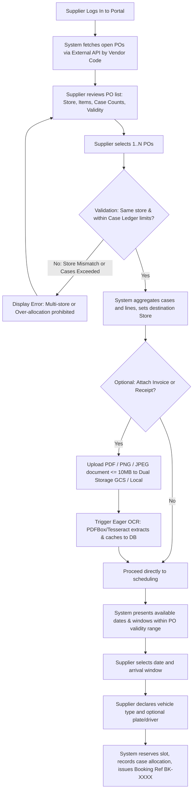
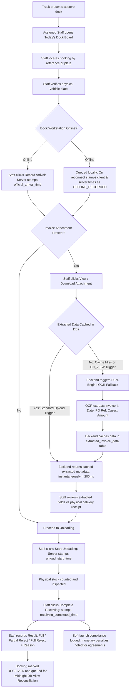
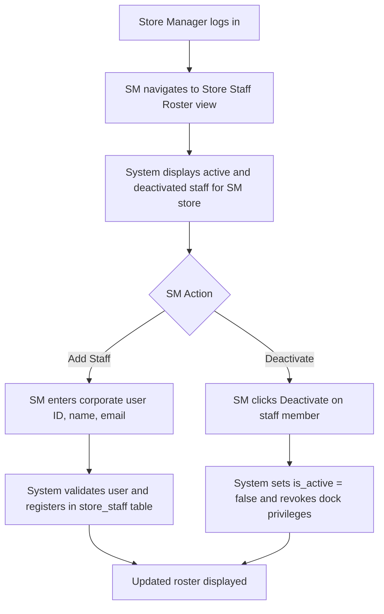
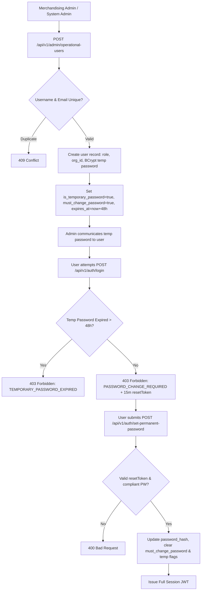
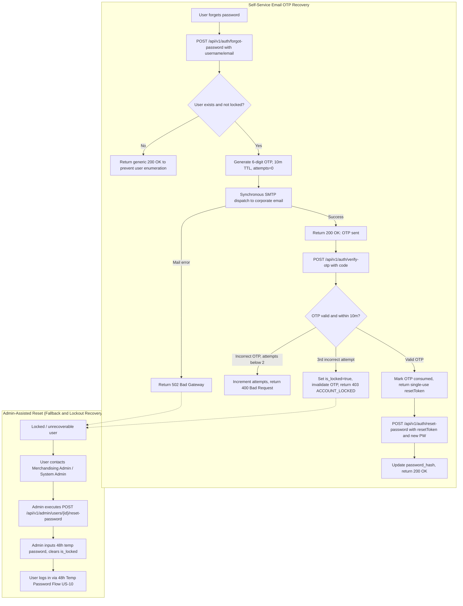
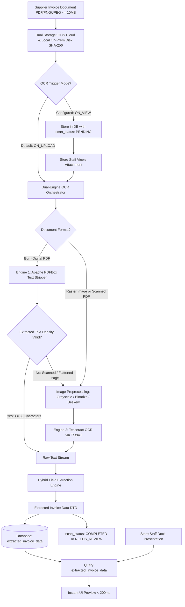
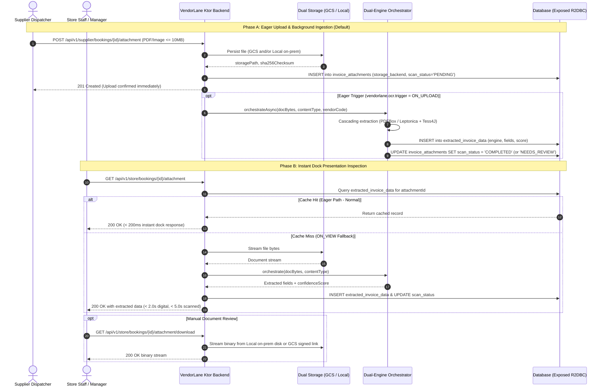
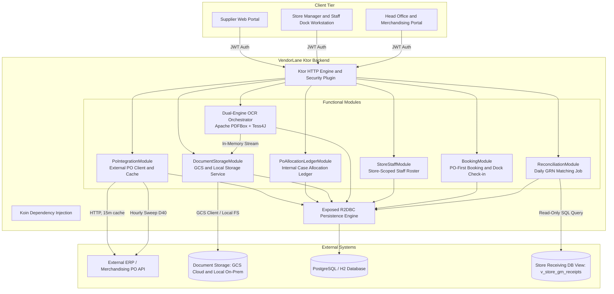
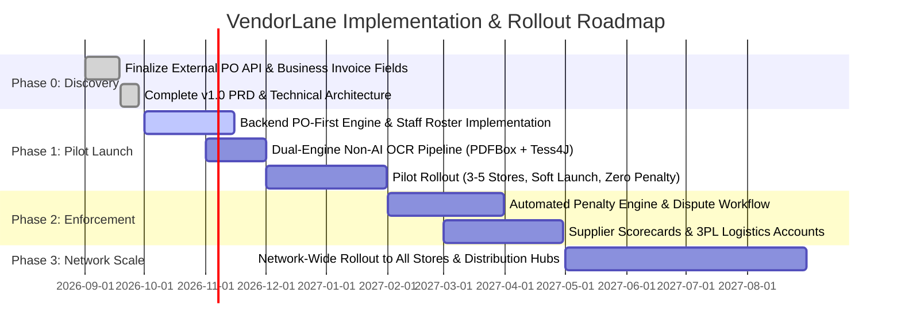

# VendorLane — Product Requirements Document (v1.4)

**Dock Appointment Scheduling System · Supplier Delivery Booking & Monitoring**

| Field | Detail |
|---|---|
| **Version** | 1.4 (Stakeholder Refinements Specification) |
| **Date** | September 2026 |
| **Status** | **Approved Specification** |
| **Document Path** | `docs/VendorLane_PRD_v1.0.md` |
| **Requesters** | Process Owners & Store Operations |
| **Primary Users** | Suppliers, Store Managers, Assigned Store Staff, Merchandising Admins, Process Owners, System Admins |

---

## 1. Executive Summary

### 1.1 Problem Statement
Suppliers currently deliver without coordinated scheduling, causing severe dock congestion, unpredictable receiving queues, and prolonged unloading dwell times. Because arrival times and delivery agreements have lacked verifiable timestamps, schedule penalties go uncollected due to disputes over unrecorded arrivals and missing purchase order documentation.

### 1.2 Proposed Solution
VendorLane provides a unified dock appointment scheduling platform where suppliers query external Purchase Orders (POs) by vendor code, inspect destination store and case counts, track allocations through an internal case ledger, optionally attach invoice documents, and book arrival windows. Store Managers maintain a store-scoped Assigned Staff roster to verify truck arrivals directly at the dock, trigger configurable eager deterministic dual-engine OCR scanning of invoice attachments on upload (orchestrating Apache PDFBox and Tesseract OCR without AI or cloud document dependencies) with dual storage across Google Cloud Storage (GCS) and on-prem local filesystem for instant dock viewing (< 200ms), and record receiving results for automated daily reconciliation via direct read-only store inventory database views.

### 1.3 Success Criteria
- **G1**: 100% of store arrivals mapped to booked windows, keeping concurrent dock traffic within effective capacity.
- **G2**: >= 90% schedule adherence (on-time arrivals within booked windows).
- **G3**: >= 95% of daily receiving (GRN) records matched against VendorLane bookings via direct database view reconciliation.
- **G4**: 100% of recorded delivery penalties backed by store staff dock arrival timestamps and reconciliation logs (with monetary penalties noted for soft-launch supplier agreements).
- **G5**: Configurable on-upload/on-demand invoice document OCR scan execution time < 2.0 seconds for born-digital PDFs via direct text extraction and < 5.0 seconds for scanned raster documents via optical character recognition, achieving >= 92% key-field extraction accuracy and < 200ms cached dock view latency.

---

## 2. User Experience & Functionality

### 2.1 Persona Realignment & Role Architecture

In this v1.0 specification, the **Driver** and **Store Receiver** personas are permanently removed based on stakeholder feedback:
- **Driver Removal**: Eliminates driver smartphone check-in links, SMS links, and mobile GPS geolocation tracking. Drivers no longer require user accounts or interaction with the system.
- **Store Receiver Removal**: Eliminates the standalone receiving specialist role. Dock check-in and receiving outcomes are transitioned entirely to the **Store Manager** and **Assigned Staff**.
- **Store-Scoped Staff Roster**: Store Managers directly manage an authorized roster of store staff (`Assigned Staff`) with dock receiving and document inspection permissions scoped to their store.
- **Authentication Parity**: Assigned Staff utilize the identical corporate credential and authentication mechanism as Store Managers (temporary passwords, JWT authentication, and self-service recovery); access control decorators restrict Assigned Staff strictly to dock receiving operations and document viewing, while roster administration remains a Store Manager duty.

| Persona | Description & Core Responsibilities | Scope & Access |
|---|---|---|
| **Supplier User** | Dispatcher/logistics staff. Queries open POs by vendor code, attaches invoice receipts, and reserves open arrival windows. | Scoped to authenticated `vendor_code` |
| **Supplier Admin** | Lead contact managing company profile, named supplier users, and notification preferences. Provisioned by Merchandising Admin with a 48-hour temporary password. | Scoped to supplier organization |
| **Store Manager (SM)** | Oversees store dock capacity, manages the Assigned Staff roster, reviews attached invoices, and handles disruptions. Provisioned by Merchandising Admin with a 48-hour temporary password. | Scoped to assigned `store_id` |
| **Assigned Staff** | Store employee authorized by the SM to confirm truck arrival at dock presentation, view/download invoices, and log receiving results. Managed directly on the localized store roster by the Store Manager. Shares standard corporate authentication with SM; permissions strictly restricted by RBAC to dock receiving and document inspection. | Scoped to assigned `store_id` |
| **Merchandising Admin** | Commercial and operational authority coordinating supplier and store operations (consolidating former Merchandiser HO responsibilities). Monitors supplier delivery compliance, adjusts schedules before cutoffs, provisions Supplier Admin and Store Manager accounts with 48-hour temporary passwords, and executes admin-assisted password resets as an escalation fallback. | System-wide Merchandising & Operations / Assigned supplier portfolio |
| **Process Owner** | Senior operations authority. Owns base capacity, configures invoice extraction schemas, reviews excusals, and oversees reconciliation exceptions. | System-wide / Network |
| **System Admin** | Top-level IT/DevOps governance authority. Provisions and oversees Merchandising Admin accounts, manages tenant configurations and API integrations, and holds full escalation override authority across all tenant domains. | Global System Administration |

---

### 2.2 User Stories & Acceptance Criteria

#### US-01: Supplier — PO-First Query and Selection
*As a Supplier User, I want to query my open Purchase Orders using my vendor code so that I can view store destinations, line items, and case counts before booking a slot.*
- **AC-01.1**: The system must query the external PO API using the supplier's authenticated `vendor_code` on demand and cache results with a 15-minute TTL.
- **AC-01.2**: Each retrieved PO must display PO number, destination store ID and name, line item count, total case count, and delivery validity dates (`validity_start` to `validity_end`).
- **AC-01.3**: The supplier must be allowed to select 1 to N POs for booking, provided all selected POs share the exact same destination `store_id`.
- **AC-01.4**: Selecting POs destined for different stores must be rejected immediately with an informative validation error before slot selection.
- **AC-01.5**: The system must aggregate total cases and unique items across all selected POs and display the summary to the supplier.
- **AC-01.6 (Internal Case Allocation Ledger)**: The system must track cumulative booked cases in an internal case allocation ledger (`booking_po_items`) across split/partial bookings to prevent over-allocation against external PO totals.
- **AC-01.7 (Upstream ERP Cancellation Sweep)**: The system must execute hourly background synchronization sweeps against external ERP POs to detect cancelled orders and automatically cancel corresponding bookings (`D40`).

#### US-02: Supplier — Optional Invoice / Receipt Document Attachment
*As a Supplier User, I want to optionally attach an invoice document or PO receipt when booking so that store receiving personnel have billing and delivery paperwork in advance.*
- **AC-02.1**: The booking interface must provide an optional file upload input supporting PDF, PNG, and JPEG file types.
- **AC-02.2**: The upload service must enforce a strict maximum file size of 10MB per document.
- **AC-02.3**: Uploaded files must be securely persisted to dual-backend document storage supporting Google Cloud Storage (GCS) and on-prem local filesystem with a generated unique identifier, storage backend tag, and SHA-256 hash.
- **AC-02.4**: Skipping attachment must remain fully valid; bookings without attachments proceed directly to date and window selection.
- **AC-02.5 (Configurable Eager OCR)**: Upon document upload, the system triggers deterministic dual-engine OCR extraction eagerly by default (configurable via `vendorlane.ocr.trigger = ON_UPLOAD | ON_VIEW`), parses structured business fields, and caches them into `extracted_invoice_data` so that receiving staff experience zero delay during dock presentation.

#### US-03: Supplier — Arrival Window Reservation
*As a Supplier User, I want to select an available arrival window for my delivery so that the store dock is prepared for my truck.*
- **AC-03.1**: The system must display open arrival windows for the destination store derived from the selected POs.
- **AC-03.2**: Booking dates must fall strictly within the delivery validity window (`validity_start` to `validity_end`) common to all selected POs.
- **AC-03.3**: Windows must be available only if booking time is outside the store cutoff (default 24 hours prior) and has effective capacity remaining.
- **AC-03.4**: Upon confirmation, the booking status transitions to `BOOKED` and a unique reference code (e.g., `BK-202609-XXXX`) is generated and returned.

#### US-04: Assigned Staff — Direct Dock Arrival Check-in
*As an Assigned Staff member, I want to record a truck's arrival directly at the dock workstation so that the official arrival timestamp is recorded without relying on driver mobile devices.*
- **AC-04.1**: The dock arrival interface must list today's expected bookings for the staff member's store, filterable by arrival window and status.
- **AC-04.2**: The staff member confirms arrival by entering or scanning the booking reference and verifying the vehicle plate number.
- **AC-04.3**: The system records the authoritative server timestamp in `Asia/Manila` (UTC+8) as `official_arrival_time`.
- **AC-04.4**: Plate mismatches between declared booking plate and presented physical truck are flagged with an audit alert but do not block check-in.
- **AC-04.5**: Unbooked trucks arriving at the dock can be registered directly by Assigned Staff or Store Manager as `ACCEPTED` or `TURNED_AWAY`.
- **AC-04.6 (Offline Soft-Launch Timestamping)**: In offline dock workstation scenarios, local check-in records are queued locally; upon reconnection within clock tolerance (<= 5 minutes), the event is synchronized, stamping both client and server timestamps and tagging as `OFFLINE_RECORDED`. Monetary penalties are deferred as soft launch agreements between the company and suppliers, prioritizing authoritative arrival timestamp recording.

#### US-05: Store Manager & Assigned Staff — Invoice Inspection and Instant Extraction Review
*As a Store Manager or Assigned Staff member, I want to view, download, and review pre-extracted details of the attached invoice so that delivery documents are verified instantaneously without dock check-in delays or cloud AI privacy risks.*
- **AC-05.1 (Instant Cached Review & On-Demand Fallback)**: When an authorized store user views a booking with an attachment, pre-extracted invoice details load instantaneously (< 200ms) from `extracted_invoice_data` cached during upload. If extraction has not yet completed or was configured for `ON_VIEW`, on-demand fallback extraction is triggered.
- **AC-05.2 (Cascading Engine Pipeline)**:
  - If the document is a vector/born-digital PDF, the system executes the **Apache PDFBox** extractor as the primary fast path.
  - If the document is an image (PNG, JPEG) or a scanned raster PDF with insufficient extractable digital text (< 50 characters or low density), the system automatically cascades to **Tesseract OCR** with image preprocessing (grayscale, Otsu binarization, deskewing).
- **AC-05.3 (Deterministic Field Extraction)**:
  - The extraction pipeline first checks for a matched **Supplier Coordinate Template** based on the booking's `vendor_code`.
  - If a template exists, fields are extracted directly from pre-calibrated XY bounding-box coordinates.
  - If no template matches or template confidence is low (< 75%), the system applies **Rule-Based Proximity Regex Heuristics** scanning for anchor keywords (e.g., `Invoice No:`, `Date:`, `PO Number:`, `Total:`, `Cases:`) and standardized value formats.
- **AC-05.4 (Extracted Data & Caching)**: Extracted fields (`invoice_number`, `invoice_date`, `po_reference`, `total_cases`, `total_amount`), composite `confidence_score`, and `extraction_engine` tag are cached in `extracted_invoice_data`. Subsequent views return cached results within 200ms.
- **AC-05.5 (Low Confidence Review Protocol)**: If the calculated `confidence_score` is below 75%, the attachment is tagged `scan_status = 'NEEDS_REVIEW'`, presenting an alert for store personnel to manually inspect the physical receipt.
- **AC-05.6 (Audit Trail & Storage Backends)**: Original file checksums, storage backend used (`GCS` vs `LOCAL`), extraction engine used (`PDFBOX` vs `TESSERACT`), and any manual store staff edits are preserved immutably in the audit log.

#### US-06: Store Manager — Store-Scoped Staff Roster Management
*As a Store Manager, I want to manage the authorized dock staff roster for my store so that only authorized personnel can log arrivals and download documents.*
- **AC-06.1**: The Store Manager can list all staff members assigned to their store (`store_staff` records).
- **AC-06.2**: The Store Manager can add a new staff member by supplying their corporate user ID, full name, and email address.
- **AC-06.3**: The Store Manager can deactivate an existing staff member, immediately revoking dock check-in and document access rights for that store.
- **AC-06.4**: Staff management endpoints must enforce strict store isolation: Store Managers cannot view or alter rosters of other stores.
- **AC-06.5 (Authentication Parity)**: Assigned Staff authenticate using the same corporate user authentication mechanism as Store Managers (JWT, 48-hour temporary password rotation, and self-service OTP recovery). Store Managers manually maintain the active roster, while RBAC decorators restrict Assigned Staff strictly to dock receiving operations and document viewing.

#### US-07: Assigned Staff & Store Manager — Unload Tracking and Receiving Result Recording
*As an Assigned Staff member, I want to record unload start and completion times along with receiving results so that store dwell time and compliance outcomes are recorded.*
- **AC-07.1**: Staff records `unload_start_time` when the truck bay door opens and unloading commences.
- **AC-07.2**: Staff records `receiving_completed_time` and selects receiving result: `FULL`, `PARTIAL_REJECT`, or `FULL_REJECT`.
- **AC-07.3**: If `PARTIAL_REJECT` or `FULL_REJECT` is selected, a standardized rejection reason code and optional notes are mandatory.
- **AC-07.4**: Receiving completion updates the booking status to `RECEIVED` and triggers the compliance evaluation rule engine.

#### US-08: Process Owner & System — Daily Receiving Reconciliation
*As a Process Owner, I want the system to automatically match daily store receiving records (GRNs) against dock bookings at midnight so that unbooked deliveries, store check-in failures, and confirmed no-shows are objectively identified.*
- **AC-08.1**: The reconciliation batch runs daily at 00:30 `Asia/Manila` querying a direct read-only store GRN database view (`v_store_grn_receipts`) to evaluate receiving records against bookings.
- **AC-08.2**: Bookings marked `RECEIVED` with matching GRN are closed as `COMPLIANT`.
- **AC-08.3**: GRNs found with no corresponding booking generate an `UNBOOKED` delivery violation.
- **AC-08.4**: Provisional no-shows with no GRN are finalized as `CONFIRMED_NO_SHOW`.
- **AC-08.5**: Bookings with no arrival recorded but with physical GRN received are marked `EXCUSED`, with a Store Receiving Breach logged against the store.

#### US-09: Merchandising Admin — Operational Account Provisioning
*As a Merchandising Admin, I want to create user accounts for Supplier Admins and Store Managers with an initial temporary password so that authorized partners can onboard securely.*
- **AC-09.1**: Merchandising Admin provides username, corporate email, role (`SUPPLIER_ADMIN` or `STORE_MANAGER`), organizational entity ID (`vendor_code` or `store_id`), and an admin-specified temporary password.
- **AC-09.2**: The temporary password is set with `is_temporary_password = true`, `temporary_password_expires_at = now() + 48 hours`, and `must_change_password = true`.
- **AC-09.3**: Duplicate usernames or email addresses are rejected with HTTP 409 Conflict.
- **AC-09.4**: All account creation events are recorded immutably in the system audit log.

#### US-10: Onboarding User — Temporary Password Login & Permanent Password Setup
*As a newly provisioned user, I want to authenticate using my temporary password and immediately establish a permanent password so that my account is personalized and secure.*
- **AC-10.1**: Attempting to log in with an expired temporary password (> 48 hours elapsed) is rejected with HTTP 403 Forbidden (`TEMPORARY_PASSWORD_EXPIRED`), directing the user to contact their Merchandising Admin.
- **AC-10.2**: Authenticating with a valid temporary password returns HTTP 403 Forbidden with a payload containing `code: "PASSWORD_CHANGE_REQUIRED"` and a short-lived `password_reset_token` (15-minute validity). No full session JWT is issued.
- **AC-10.3**: Submitting the `password_reset_token` along with a new permanent password conforming to password complexity rules updates the account, clears `is_temporary_password` and `must_change_password`, and issues a full access JWT.

#### US-11: User — Self-Service Email OTP Password Recovery
*As a registered user, I want to request a one-time password sent to my email so that I can independently recover access to my account if I forget my password.*
- **AC-11.1**: User enters their registered username or email address at the forgot-password endpoint.
- **AC-11.2**: System generates a 6-digit numeric OTP valid for 10 minutes and dispatches it synchronously via SMTP.
- **AC-11.3**: Verifying the OTP allows up to 3 failed attempts. If 3 consecutive incorrect OTPs are entered, the OTP is invalidated, self-service recovery is locked for that account (`is_locked = true`), and the user is instructed to contact their administrator.
- **AC-11.4**: On successful OTP verification, the system issues a single-use `password_reset_token` enabling the user to submit a new permanent password.

#### US-12: System Admin & Merchandising Admin — Admin-Assisted Account Reset
*As an Administrator, I want to reset a user's password using a newly issued temporary password so that locked or unrecoverable accounts can be restored.*
- **AC-12.1**: System Admin can reset Merchandising Admin and system accounts; Merchandising Admin can reset Supplier and Store accounts (System Admin retains escalation override).
- **AC-12.2**: The administrator manually enters a temporary password.
- **AC-12.3**: The system updates the user record, sets `temporary_password_expires_at = now() + 48 hours`, sets `must_change_password = true`, and clears any recovery lockout flags (`is_locked = false`).
- **AC-12.4**: The user must log in within 48 hours and complete the permanent password setup flow (US-10).

---

### 2.3 User Flows

#### A. PO-First Supplier Booking Flow


#### B. Store Dock Receiving & Instant Scan Inspection Flow


#### C. Store Staff Roster Management Flow


#### D. Administrative Account Provisioning & Temporary Password Flow


#### E. Account Recovery Flow (Self-Service Email OTP & Admin-Assisted Reset)


---

### 2.4 Non-Goals

| Non-Goal | Rationale & Architectural Boundary |
|---|---|
| **Driver Self-Service & GPS Geolocation** | Eliminated by business decision. Drivers have no system accounts, mobile apps, or check-in links. Arrival timestamps are established exclusively by store personnel. |
| **Standalone Store Receiver Role** | Eliminated. Dock operations are performed strictly by Store Managers and their managed Assigned Staff. |
| **Editing PO Line Items or Quantities** | POs remain master data owned by the host ERP/merchandising system. VendorLane reads POs in a read-only capacity. |
| **Direct Financial Debit of Supplier Penalties** | Financial settlement and invoice debiting are out of scope for Phase 1 and will be introduced in Phase 2 with ERP/Accounts Payable integration. |
| **Automatic Boom Barrier Hardware Integration** | Dock gate booms, IoT weight bridges, and automated barrier controllers are out of scope for the software platform. |
| **Quality or Shelf-Life Rejection Arbitrations** | Detailed quality assurance audits and temperature log compliance remain in store inventory receiving workflows; VendorLane only captures the high-level receiving outcome code. |
| **No Cloud Document AI APIs** | AWS Textract, Google Cloud Document AI, and Azure AI are strictly excluded to avoid recurring per-page API costs, vendor lock-in, and cloud data egress compliance issues. |
| **No Generative AI or LLMs** | Large Language Models are non-deterministic, computationally expensive, and introduce hallucination risks on financial and case-count delivery figures. All extraction must be deterministic and verifiable. |
| **No Heavyweight GPU Infrastructure** | Processing must execute within the standard JVM container CPU footprint without requiring dedicated GPU acceleration or large PyTorch/TensorFlow runtimes. |

---

## 3. Document Intelligence & Dual-Engine OCR Requirements (Deterministic Non-AI Pipeline)

### 3.1 Configurable Eager Invoice Scanning & Cascading Orchestration Architecture
The document processing subsystem extracts structured business metadata from uploaded supplier invoice receipts and PO slips. To guarantee zero cloud recurring costs, eliminate external API latency, and avoid non-deterministic Generative AI hallucinations, the system implements an in-process, deterministic **dual-engine open-source OCR orchestration pipeline** combining **Apache PDFBox** and **Tesseract OCR (via Tess4J)**.

Document processing follows a **Configurable Eager Scan on Upload** model (`vendorlane.ocr.trigger = ON_UPLOAD | ON_VIEW`) orchestrated via cascading fallback. By default, extraction executes immediately upon document upload in the background, caching parsed business fields directly into `extracted_invoice_data`. When Store Managers or Assigned Staff access the booking during physical dock presentation, pre-extracted invoice details load instantaneously (< 200ms) with zero dock check-in delay. If the document was uploaded under `ON_VIEW` configuration or extraction was still pending, an on-demand fallback extraction is performed transparently:





### 3.2 Dual-Engine Specifications & Cascading Decision Rules
- **Ingestion Formats**: PDF (vector and scanned raster), PNG, JPEG.
- **Maximum Payload**: 10MB per document.
- **Storage Strategy**: Files are stored using an abstracted `DocumentStorageService` supporting Google Cloud Storage (GCS) for production cloud deployments and on-prem local filesystem storage for local development and store preview caching. Files are stored using immutable SHA-256 hashed paths and tracked with `storage_backend` (`GCS` vs `LOCAL`). Raw files are never exposed publicly; access requires authenticated signed streaming endpoints.
- **Configurable Pipeline Trigger**: Configured via `vendorlane.ocr.trigger` (`ON_UPLOAD` vs `ON_VIEW`). Defaults to `ON_UPLOAD` for zero dock latency, while preserving on-demand `ON_VIEW` fallback capability.
- **Dual Open-Source Engines**:
  1. **Primary Engine (Apache PDFBox 3.x)**:
     - Directly strips native vector text streams and font glyph encodings from born-digital PDFs.
     - Sub-second turnaround (< 2.0s), 100% character precision, zero optical recognition artifacts.
  2. **Secondary Engine (Tesseract OCR 5.x via Tess4J with Leptonica)**:
     - Local optical character recognition for scanned paper receipts, mobile camera captures, and rasterized images.
     - **Image Preprocessing Pipeline**: Before OCR recognition, images pass through Leptonica/AWT preprocessing:
       - 8-bit grayscale conversion.
       - Otsu adaptive threshold binarization for high-contrast separation.
       - Automated deskewing algorithm (correcting skew angles within +/- 15 degrees).
     - Generates bounding-box coordinates and word-level statistical confidence scores for each token.
- **Cascading Routing Rules**:
  - **Rule 1 (Fast-Path Vector PDF Check)**: On document ingestion, the orchestrator inspects the MIME type and internal PDF structure. If born-digital, Apache PDFBox extracts the raw text stream.
  - **Rule 2 (Density Evaluation)**: If Apache PDFBox returns >= 50 recognizable text characters, the document is classified as `DIGITAL_PDF` and bypasses the optical OCR engine completely.
  - **Rule 3 (Raster Fallback)**: If the document is an image (PNG/JPEG) or a scanned raster PDF with < 50 characters of digital text, the pages are converted to raster images, passed through the Leptonica preprocessing pipeline, and recognized via Tesseract OCR (`TESSERACT` engine tag).
- **OCR Engine Adapters & Service Contracts**:
  VendorLane organizes deterministic text extraction and field parsing behind modular Kotlin interfaces:
  ```kotlin
  package com.puregold.vendorlane.ocr

  import java.io.InputStream
  import kotlinx.serialization.Serializable

  /**
   * High-level orchestration contract for invoice scanning.
   */
  interface InvoiceScannerService {
      suspend fun scanInvoice(
          attachmentId: String,
          vendorCode: String,
          contentType: String,
          fileStream: InputStream
      ): ExtractedInvoiceDataDto
  }

  /**
   * Primary engine for born-digital vector PDFs.
   */
  interface PdfBoxTextExtractor {
      fun isDigitalPdf(inputStream: InputStream): Boolean
      fun extractText(inputStream: InputStream): RawTextExtractionResult
  }

  /**
   * Secondary optical engine for raster images and scanned documents.
   */
  interface TesseractOcrExtractor {
      fun extractText(imageStream: InputStream): RawOcrExtractionResult
  }

  /**
   * Hybrid deterministic field parsing engine.
   */
  interface InvoiceFieldParser {
      fun parse(
          rawText: String,
          vendorCode: String,
          coordinateTokens: List<OcrWordToken> = emptyList()
      ): ExtractedInvoiceDataDto
  }

  data class RawTextExtractionResult(
      val fullText: String,
      val characterCount: Int,
      val pageCount: Int,
      val isScannedOnly: Boolean
  )

  data class OcrWordToken(
      val text: String,
      val x: Int,
      val y: Int,
      val width: Int,
      val height: Int,
      val confidence: Double
  )

  data class RawOcrExtractionResult(
      val fullText: String,
      val tokens: List<OcrWordToken>,
      val averageConfidence: Double
  )

  @Serializable
  data class ExtractedInvoiceDataDto(
      val attachmentId: String,
      val invoiceNumber: String?,
      val invoiceDate: String?,
      val poReference: String?,
      val totalAmount: Double?,
      val totalCases: Int?,
      val confidenceScore: Double,
      val extractionEngine: String, // "PDFBOX" or "TESSERACT"
      val templateMatched: Boolean,
      val rawExtractedJson: String
  )
  ```
- **Hybrid Deterministic Field Extraction Engine**:
  Extracted text streams or OCR word tokens pass to the `InvoiceFieldParser` which applies a deterministic two-tier strategy:
  1. **Tier 1: Supplier Coordinate Bounding-Box Templates**:
     - Pre-calibrated JSON templates indexed by supplier `vendor_code`.
     - Defines normalized bounding boxes `[x1, y1, x2, y2]` (percentage of page width/height) for target header fields (`invoice_number`, `invoice_date`, `po_reference`) and summary fields (`total_cases`, `total_amount`).
     - Directly captures words whose token coordinates overlap with defined field boxes.
  2. **Tier 2: Rule-Based Proximity Regex Heuristics**:
     - Fallback triggered automatically if no template exists for the vendor or if template confidence is < 75%.
     - Searches for standard document anchor keywords and extracts adjacent structured values using regular expressions:
       - **`invoice_number`**: `(?:Invoice|Inv|SI|Delivery Receipt|DR)[\s#.:-]*([A-Z0-9\/-]{4,25})`
       - **`invoice_date`**: `(?:Date|Dated)[\s.:-]*(\d{1,2}[-\/.]\d{1,2}[-\/.]\d{2,4}|\w+ \d{1,2},? \d{4})` (normalized to ISO-8601 `YYYY-MM-DD`).
       - **`po_reference`**: `(?:PO|P\.O\.|Purchase Order)[\s#.:-]*([A-Z0-9\/-]{5,30})`
       - **`total_cases`**: `(?:Total Cases|Cases|Cartons|Qty|Total Qty)[\s.:-]*(\d{1,6})`
       - **`total_amount`**: `(?:Total Amount|Grand Total|Net Amount|Total)[\s.:-]*PHP?[\s]*([0-9,]+\.\d{2})`
  3. **Per-Field & Composite Confidence Formulas**:
     - Each field receives a confidence rating $C_{\text{field}} \in [0.0, 1.0]$ based on coordinate boundary fit or keyword anchor proximity and syntax validation.
     - The composite `confidence_score` is computed as a weighted sum:
       $$\text{Confidence Score} = 0.25 \times C_{\text{inv}} + 0.20 \times C_{\text{date}} + 0.25 \times C_{\text{po}} + 0.15 \times C_{\text{cases}} + 0.15 \times C_{\text{amount}}$$
     - If `confidence_score < 0.75`, the document is marked `scan_status = 'NEEDS_REVIEW'`.

### 3.3 Evaluation Strategy & Quality Metrics
Document extraction quality is measured against an annotated gold standard benchmark of 100 historical supplier delivery documents spanning major FMCG, perishables, and general merchandise suppliers (50 born-digital vector PDFs and 50 scanned paper/mobile receipts).

| Metric | Evaluation Method | Target KPI |
|---|---|---|
| **Invoice Number Precision** | Exact string match vs. verified invoice ground truth | >= 95.0% |
| **PO Reference Precision** | Exact match of PO number substring against booking POs | >= 95.0% |
| **Invoice Date Accuracy** | Normalized date match (day/month/year tolerance = 0) | >= 92.0% |
| **Case Count Accuracy** | Numeric equality vs. physical case count summary | >= 90.0% |
| **Total Amount Precision** | Floating-point match within 0.01 tolerance | >= 90.0% |
| **Digital PDF Turnaround** | Clock time for Apache PDFBox direct text stream extraction | < 2.0 seconds |
| **Scanned Raster Turnaround** | Clock time for Leptonica preprocessing + Tesseract OCR recognition | < 5.0 seconds |
| **Overall Extraction Accuracy** | Key-field extraction precision across standard documents | >= 92.0% |
| **Cached Response Latency** | Response time for subsequent views from database cache | < 200 ms |

#### Deterministic Evaluation Suite & Scenarios
1. **Born-Digital PDF Evaluation (Apache PDFBox Fast Path)**:
   - **Dataset**: 50 ground-truth vector PDFs generated by standard ERPs (SAP, Oracle, QuickBooks).
   - **Criteria**: Direct text stream extraction completes in < 2.0s; character density check flags digital text (>= 50 chars); zero Tesseract CPU invocation; precision >= 98% on `invoice_number`, `po_reference`, and `total_amount`.
2. **Scanned Receipt & Image Evaluation (Tesseract OCR Fallback)**:
   - **Dataset**: 50 flatbed-scanned and smartphone-photographed delivery receipts (PNG, JPEG, scanned PDFs).
   - **Criteria**: Preprocessing pipeline executes deskewing (+/- 15 degrees) and Otsu binarization; Tesseract OCR completes in < 5.0s; key-field precision >= 92%.
3. **Coordinate Template vs. Proximity Regex Fallback**:
   - **Scenario A (Template Matched)**: Invoices matching configured supplier templates extract fields directly from calibrated XY bounding boxes with confidence >= 90%.
   - **Scenario B (Unconfigured / Variable Template)**: Novel or unregistered supplier layouts trigger proximity regex heuristics, extracting anchor-adjacent values.
   - **Scenario C (Low Quality / Degraded Receipt)**: Extraction confidence below 75% flags document as `scan_status = 'NEEDS_REVIEW'` without failing or blocking the receiving flow.

#### Exception & Fallback Protocol
- **Low Confidence Threshold**: If `confidence_score < 0.75`, the system tags the extraction as `scan_status = 'NEEDS_REVIEW'`.
- **Store Staff Review Action**: The UI presents an inline banner alerting the staff member to cross-check extracted values against the downloaded original document before completing receiving.
- **Manual Override Audit**: If a Store Manager updates extracted values, the modification is recorded in the immutable audit log with user ID, previous value, new value, and manager note.
- **Deterministic Non-AI Verification**:
  - Zero external cloud AI API calls (no external API keys, egress traffic, or per-page costs).
  - Zero GPU or deep learning framework runtime dependencies in container images.
  - 100% deterministic reproducibility: re-evaluating the same document yields identical token boundaries and parsed values.

---

## 4. Technical Specifications

### 4.1 System Architecture Overview

VendorLane is implemented as a modular Kotlin/Ktor service on Java 21, leveraging Exposed R2DBC for asynchronous persistence and Koin for dependency injection.


---

### 4.2 Integration Points & API Contracts

#### Core HTTP Endpoints

| Method | Endpoint Path | Auth Scopes | Request Body | Response Body | Description |
|---|---|---|---|---|---|
| `GET` | `/api/v1/supplier/purchase-orders` | `ROLE_SUPPLIER` | None | `List<ExternalPurchaseOrderDto>` | Queries open POs for the caller's authenticated `vendor_code` via external API (cached 15 min). |
| `POST` | `/api/v1/supplier/bookings` | `ROLE_SUPPLIER` | `CreateBookingRequest` | `BookingDto` | Validates multi-PO store uniformity, PO validity dates, and case allocation ledger before reserving arrival window. |
| `POST` | `/api/v1/supplier/bookings/{id}/attachment` | `ROLE_SUPPLIER` | Multipart Form Data | `InvoiceAttachmentDto` | Uploads PDF/PNG/JPEG invoice attachment (max 10MB) to GCS/Local storage; triggers eager OCR extraction and DB caching. |
| `GET` | `/api/v1/store/staff` | `ROLE_STORE_MANAGER` | None | `List<StoreStaffDto>` | Lists authorized dock staff roster for the caller's store. |
| `POST` | `/api/v1/store/staff` | `ROLE_STORE_MANAGER` | `CreateStoreStaffRequest` | `StoreStaffDto` | Adds a staff member to the store's dock roster. |
| `DELETE` | `/api/v1/store/staff/{id}` | `ROLE_STORE_MANAGER` | None | `StatusResponse` | Deactivates a staff member from the store dock roster. |
| `GET` | `/api/v1/store/bookings/today` | `ROLE_STORE_MANAGER`, `ROLE_STORE_STAFF` | Query Params: `date`, `status` | `List<BookingDto>` | Lists today's scheduled dock arrivals for the caller's store. |
| `POST` | `/api/v1/store/bookings/{id}/arrival` | `ROLE_STORE_MANAGER`, `ROLE_STORE_STAFF` | `RecordArrivalRequest` | `BookingDto` | Records official arrival timestamp (`Asia/Manila`) directly at the dock; handles offline sync with dual timestamps. |
| `GET` | `/api/v1/store/bookings/{id}/attachment` | `ROLE_STORE_MANAGER`, `ROLE_STORE_STAFF` | None | `InvoiceAttachmentDto` | Retrieves pre-extracted attachment metadata (< 200ms) from DB cache; triggers on-demand OCR fallback if cache miss. |
| `GET` | `/api/v1/store/bookings/{id}/attachment/download` | `ROLE_STORE_MANAGER`, `ROLE_STORE_STAFF` | None | Binary Stream (`application/octet-stream`) | Streams raw original invoice file with Content-Disposition header from local preview disk or GCS signed link. |
| `POST` | `/api/v1/store/bookings/{id}/unload-start` | `ROLE_STORE_MANAGER`, `ROLE_STORE_STAFF` | None | `BookingDto` | System-stamps `unload_start_time` when truck bay door opens. |
| `POST` | `/api/v1/store/bookings/{id}/receiving-result` | `ROLE_STORE_MANAGER`, `ROLE_STORE_STAFF` | `RecordReceivingResultRequest` | `BookingDto` | Records `receiving_completed_time` and result: Full, Partial Reject, Full Reject + reason. |
| `POST` | `/api/v1/store/bookings/unbooked` | `ROLE_STORE_MANAGER`, `ROLE_STORE_STAFF` | `RecordUnbookedArrivalRequest` | `UnbookedArrivalDto` | Logs an unbooked vehicle arrival as `ACCEPTED` or `TURNED_AWAY`. |
| `GET` | `/api/v1/scenarios` | Authenticated Roles | Query Params: `storeId`, `activeOnly` | `List<DisruptionScenarioDto>` | Lists active disruption scenarios affecting dock capacity. |
| `POST` | `/api/v1/reconciliation/daily-run` | `ROLE_PROCESS_OWNER`, `ROLE_ADMIN` | `DailyReconciliationRequest` | `ReconciliationSummaryDto` | Triggers daily batch reconciliation between bookings and receiving records from direct DB view `v_store_grn_receipts`. |

---

### 4.3 Data Models & Kotlin Serialization Contracts

```kotlin
package com.puregold.vendorlane.model

import kotlinx.serialization.Serializable

// --- External Purchase Order Contracts ---

@Serializable
data class ExternalPurchaseOrderDto(
    val poNumber: String,
    val vendorCode: String,
    val storeId: String,
    val storeName: String,
    val totalCases: Int,
    val totalItems: Int,
    val validityStart: String, // ISO-8601 YYYY-MM-DD
    val validityEnd: String,   // ISO-8601 YYYY-MM-DD
    val items: List<PoItemDto>
)

@Serializable
data class PoItemDto(
    val sku: String,
    val description: String,
    val quantity: Int,
    val unitOfMeasure: String
)

// --- Invoice Attachment & On-Demand Scan Contracts ---

@Serializable
enum class ScanStatus {
    PENDING,
    COMPLETED,
    NEEDS_REVIEW,
    FAILED
}

@Serializable
data class InvoiceAttachmentDto(
    val id: String,
    val bookingId: String,
    val originalFileName: String,
    val contentType: String,
    val fileSizeBytes: Long,
    val storagePath: String,
    val storageBackend: String, // "GCS" or "LOCAL"
    val sha256Checksum: String,
    val uploadedAt: String,
    val scanStatus: ScanStatus,
    val extractedData: ExtractedInvoiceDataDto?
)

@Serializable
data class ExtractedInvoiceDataDto(
    val id: String,
    val attachmentId: String,
    val invoiceNumber: String?,
    val invoiceDate: String?,
    val poReference: String?,
    val totalAmount: Double?,
    val totalCases: Int?,
    val confidenceScore: Double,
    val extractionEngine: String, // "PDFBOX" or "TESSERACT"
    val templateMatched: Boolean,
    val rawExtractedJson: String,
    val extractedAt: String
)

// --- Store Staff Roster Contracts ---

@Serializable
data class StoreStaffDto(
    val id: String,
    val storeId: String,
    val userId: String,
    val fullName: String,
    val email: String,
    val isActive: Boolean,
    val createdByManagerId: String,
    val createdAt: String
)

@Serializable
data class CreateStoreStaffRequest(
    val userId: String,
    val fullName: String,
    val email: String
)

// --- Booking & Dock Execution Contracts ---

@Serializable
enum class BookingStatus {
    REQUESTED,
    BOOKED,
    FOR_RESCHEDULE,
    ARRIVED,
    UNLOADING,
    RECEIVED,
    NO_SHOW_PROVISIONAL,
    NO_SHOW,
    CANCELLED,
    DECLINED
}

@Serializable
enum class ReceivingResultType {
    FULL,
    PARTIAL_REJECT,
    FULL_REJECT
}

@Serializable
data class CreateBookingRequest(
    val poNumbers: List<String>,
    val deliveryDate: String, // YYYY-MM-DD
    val windowStart: String,   // HH:mm
    val windowEnd: String,     // HH:mm
    val vehicleType: String,
    val plateNumber: String?,
    val driverName: String?
)

@Serializable
data class BookingPoItemDto(
    val id: String,
    val bookingId: String,
    val poNumber: String,
    val allocatedCases: Int,
    val totalCases: Int,
    val totalItems: Int,
    val isFinal: Boolean
)

@Serializable
data class BookingDto(
    val id: String,
    val bookingReference: String,
    val supplierId: String,
    val vendorCode: String,
    val storeId: String,
    val poNumbers: List<String>,
    val poItems: List<BookingPoItemDto> = emptyList(),
    val arrivalWindowStart: String,
    val arrivalWindowEnd: String,
    val vehicleType: String,
    val plateNumber: String?,
    val driverName: String?,
    val status: BookingStatus,
    val officialArrivalTime: String?,
    val checkedInByStaffId: String?,
    val isOfflineRecorded: Boolean = false,
    val clientRecordedTime: String? = null,
    val unloadStartTime: String?,
    val receivingCompletedTime: String?,
    val receivingResult: ReceivingResultType?,
    val rejectionReasonCode: String?,
    val rejectionNotes: String?,
    val attachment: InvoiceAttachmentDto?,
    val createdAt: String
)

@Serializable
data class RecordArrivalRequest(
    val plateNumber: String,
    val notes: String? = null,
    val isOfflineRecorded: Boolean = false,
    val clientRecordedTime: String? = null
)

@Serializable
data class RecordReceivingResultRequest(
    val result: ReceivingResultType,
    val rejectionReasonCode: String? = null,
    val notes: String? = null
)
```

---

### 4.4 Exposed Database Schema Definitions

```kotlin
package com.puregold.vendorlane.schema

import org.jetbrains.exposed.dao.id.IdTable
import org.jetbrains.exposed.sql.javatime.timestamp

object StoreStaffTable : IdTable<String>("store_staff") {
    override val id = varchar("id", 36).entityId()
    val storeId = varchar("store_id", 36).index()
    val userId = varchar("user_id", 36).uniqueIndex()
    val fullName = varchar("full_name", 100)
    val email = varchar("email", 100)
    val isActive = bool("is_active").default(true)
    val createdByManagerId = varchar("created_by_manager_id", 36)
    val createdAt = timestamp("created_at")
    override val primaryKey = PrimaryKey(id)
}

object InvoiceAttachmentsTable : IdTable<String>("invoice_attachments") {
    override val id = varchar("id", 36).entityId()
    val bookingId = varchar("booking_id", 36).uniqueIndex()
    val originalFileName = varchar("original_file_name", 255)
    val contentType = varchar("content_type", 100)
    val fileSizeBytes = long("file_size_bytes")
    val storagePath = text("storage_path")
    val storageBackend = varchar("storage_backend", 30).default("LOCAL") // "GCS", "LOCAL"
    val sha256Checksum = varchar("sha256_checksum", 64)
    val scanStatus = varchar("scan_status", 20).default("PENDING")
    val uploadedAt = timestamp("uploaded_at")
    override val primaryKey = PrimaryKey(id)
}

object ExtractedInvoiceDataTable : IdTable<String>("extracted_invoice_data") {
    override val id = varchar("id", 36).entityId()
    val attachmentId = reference("attachment_id", InvoiceAttachmentsTable.id)
    val invoiceNumber = varchar("invoice_number", 100).nullable()
    val invoiceDate = varchar("invoice_date", 50).nullable()
    val poReference = varchar("po_reference", 100).nullable()
    val totalAmount = double("total_amount").nullable()
    val totalCases = integer("total_cases").nullable()
    val confidenceScore = double("confidence_score")
    val extractionEngine = varchar("extraction_engine", 30) // "PDFBOX", "TESSERACT", "MANUAL_OVERRIDE"
    val templateMatched = bool("template_matched").default(false)
    val rawExtractedJson = text("raw_extracted_json")
    val extractedAt = timestamp("extracted_at")
    override val primaryKey = PrimaryKey(id)
}

object BookingsTable : IdTable<String>("bookings") {
    override val id = varchar("id", 36).entityId()
    val bookingReference = varchar("booking_reference", 30).uniqueIndex()
    val supplierId = varchar("supplier_id", 36).index()
    val vendorCode = varchar("vendor_code", 36).index()
    val storeId = varchar("store_id", 36).index()
    val arrivalWindowStart = timestamp("arrival_window_start")
    val arrivalWindowEnd = timestamp("arrival_window_end")
    val vehicleType = varchar("vehicle_type", 50)
    val plateNumber = varchar("plate_number", 20).nullable()
    val driverName = varchar("driver_name", 100).nullable()
    val status = varchar("status", 30).default("BOOKED")
    val officialArrivalTime = timestamp("official_arrival_time").nullable()
    val checkedInByStaffId = varchar("checked_in_by_staff_id", 36).nullable()
    val isOfflineRecorded = bool("is_offline_recorded").default(false)
    val clientRecordedTime = timestamp("client_recorded_time").nullable()
    val unloadStartTime = timestamp("unload_start_time").nullable()
    val receivingCompletedTime = timestamp("receiving_completed_time").nullable()
    val receivingResult = varchar("receiving_result", 30).nullable()
    val rejectionReasonCode = varchar("rejection_reason_code", 50).nullable()
    val rejectionNotes = text("rejection_notes").nullable()
    val createdAt = timestamp("created_at")
    override val primaryKey = PrimaryKey(id)
}

object BookingPoItemsTable : IdTable<String>("booking_po_items") {
    override val id = varchar("id", 36).entityId()
    val bookingId = reference("booking_id", BookingsTable.id)
    val poNumber = varchar("po_number", 50).index()
    val allocatedCases = integer("allocated_cases")
    val totalCases = integer("total_cases")
    val totalItems = integer("total_items")
    val isFinal = bool("is_final").default(true)
    override val primaryKey = PrimaryKey(id)
}

object AuditLogTable : IdTable<String>("audit_log") {
    override val id = varchar("id", 36).entityId()
    val entityType = varchar("entity_type", 50) // BOOKING, ATTACHMENT, STAFF, SCENARIO
    val entityId = varchar("entity_id", 36)
    val action = varchar("action", 50)         // CREATE, UPDATE, ARRIVAL, SCAN, DEACTIVATE
    val performedByUserId = varchar("performed_by_user_id", 36)
    val performedByRole = varchar("performed_by_role", 50)
    val oldStateJson = text("old_state_json").nullable()
    val newStateJson = text("new_state_json").nullable()
    val reason = text("reason").nullable()
    val timestamp = timestamp("timestamp")
    override val primaryKey = PrimaryKey(id)
}
```

---

### 4.5 Security, Authorization & Data Isolation

1. **Role-Based Access Control (RBAC)**:
   - Tokens are signed JWTs containing user identity, roles (`ROLE_SUPPLIER`, `ROLE_STORE_MANAGER`, `ROLE_STORE_STAFF`, `ROLE_MERCHANDISING_ADMIN`, `ROLE_PROCESS_OWNER`, `ROLE_SYSTEM_ADMIN`), and tenancy attributes (`vendor_code` or `store_id`).
2. **Tenant Data Scoping**:
   - **Suppliers**: Restricted strictly to booking records and PO queries where `vendor_code == token.vendor_code`. Cross-supplier visibility is blocked at the SQL query predicate level.
   - **Store Staff & Managers**: Restricted strictly to bookings, staff rosters, and dock schedules where `store_id == token.store_id`.
   - **Merchandising Admins**: View access across all network stores, schedule adjustment rights for assigned supplier portfolios, and account provisioning authority for Supplier Admins and Store Managers.
3. **Document Security & Storage**:
   - Files are stored in encrypted private storage (Google Cloud Storage and on-prem local filesystem) with randomized hash keys.
   - Direct download URLs are short-lived signed URLs (15-minute TTL) generated only for authenticated Store Managers and Assigned Staff of the destination store.
4. **Audit Immutability**:
   - Audit logs are append-only. No `UPDATE` or `DELETE` endpoints or database permissions exist for the `audit_log` table.
5. **Assigned Staff Authentication & Scoping Parity**:
   - Assigned Staff authenticate using the exact same mechanism as Store Managers (corporate user identity, JWT bearer authentication, 48-hour temporary password rotation, and self-service recovery).
   - Roster assignment (`store_staff`) is maintained manually by Store Managers for their respective `store_id`.
   - RBAC decorators restrict Assigned Staff strictly to dock receiving operations (arrival check-in, bay door unloading, receiving results) and document viewing/downloading; roster administration endpoints are accessible strictly to `ROLE_STORE_MANAGER`.

---

## 5. Risks & Phased Roadmap

### 5.1 Phased Implementation Roadmap



| Phase | Core Deliverables | Entry / Exit Criteria |
|---|---|---|
| **Phase 0 — Discovery & Design** | • External PO API gateway integration contract.<br/>• Business-level invoice field configuration confirmed.<br/>• Pilot store selection (3–5 stores with diverse volume). | **Exit**: Approved v1.0 PRD and signed-off API schema contracts. |
| **Phase 1 — Pilot Launch (Soft Launch)** | • PO-First booking flow and on-demand external PO retrieval with 15-minute TTL cache.<br/>• Internal Case Allocation Ledger & hourly upstream cancellation sweep (`D40`).<br/>• Store Manager staff roster management (`store_staff`) with authentication parity for Assigned Staff.<br/>• Store Staff direct dock check-in, soft-launch timestamping, and receiving result recording.<br/>• Dual-Engine OCR Pipeline (PDFBox + Tess4J) with eager scanning on upload and dual storage (GCS & Local on-prem).<br/>• Daily automated reconciliation against receiving (GRN) records via direct read-only database view.<br/>• **Enforcement Policy**: Soft launch — violations recorded on scorecard, zero financial deductions charged (penalties noted for supplier agreements). | **Exit**: >= 95% booking match rate, >= 90% dock staff check-in compliance across pilot stores. |
| **Phase 2 — Penalty Enforcement** | • Financial penalty calculation engine and supplier dispute portal.<br/>• Possible-cascade dispute fast-tracking.<br/>• Consolidated / 3PL Logistics Provider multi-PO accounts.<br/>• SMS delivery alerts and urgent booking notifications. | **Exit**: Legal and Procurement sign-off on penalty billing agreements; first penalty cycle reconciled. |
| **Phase 3 — Network Scale** | • Enterprise rollout across all retail supermarket branches and regional distribution centers.<br/>• Predictive arrival scheduling heuristics and dynamic dock turnaround scheduling.<br/>• Automated accounts payable invoice deduction integration. | **Exit**: 100% network inbound deliveries scheduled through VendorLane. |

---

### 5.2 Technical Risks, Failure Modes & Mitigations

| Risk & Failure Mode | Severity | Probability | Concrete Mitigation Strategy |
|---|---|---|---|
| **External PO API Downtime or Latency**<br/>Upstream ERP/merchandising system is slow (>2s) or unavailable during supplier booking. | High | Medium | **15-Minute In-Memory / Distributed Caching**: Active open POs are cached upon first retrieval. If the external API fails, cached POs remain bookable.<br/>**Emergency Fallback Booking Mode**: If external PO API is unreachable and cache is cold, suppliers can enter PO numbers manually; booking is flagged as `NEEDS_PO_VALIDATION` requiring SM approval before docking. |
| **Concurrent PO Over-Allocation (Split Bookings)**<br/>Multiple dispatchers book remaining cases of the same PO concurrently, exceeding total PO quantity. | High | Medium | **Internal Case Allocation Ledger**: System tracks allocated cases against total cases in `booking_po_items` within atomic database transactions (`suspendTransaction`), rejecting bookings that exceed remaining case balance. Additionally, an hourly cancellation sweep detects upstream ERP cancellations (`D40`). |
| **OCR Low Extraction Confidence or Layout Variability**<br/>Suppliers upload wrinkled receipts, skewed mobile photos, or non-standard invoice templates. | Medium | High | **Image Preprocessing Pipeline**: Leptonica grayscale conversion, Otsu adaptive thresholding, and automated deskewing (+/- 15 degrees) clean photographed mobile receipts prior to Tesseract OCR execution.<br/>**Cascading Hybrid Parsing**: Recurring supplier formats match pre-calibrated XY coordinate bounding-box templates; novel layouts automatically cascade to rule-based proximity regex heuristics.<br/>**Configurable Eager Execution & Review Flag**: Scanning runs eagerly on upload by default so dock personnel experience zero delay (< 200ms preview). Extractions with confidence < 75% trigger `scan_status = 'NEEDS_REVIEW'` for visual staff inspection without blocking unloading.<br/>**Local In-Process Execution**: Apache PDFBox and Tess4J execute entirely within local JVM container CPU resources, eliminating external cloud API downtime and per-page egress/licensing costs.<br/>**Deterministic Benchmark Suite**: Continuous verification against a fixed 100-document test suite (50 digital, 50 scanned) ensures reproducible precision without model drift. |
| **Dock Workstation Connectivity Outage**<br/>Store loses internet connectivity during receiving operations. | Medium | Medium | **Offline Client Mode & Dual Timestamping**: Dock workstations cache today's expected schedule locally in IndexedDB. Arrivals and receiving timestamps are queued locally and synchronized with server upon reconnection, recording both client and server timestamps tagged `OFFLINE_RECORDED`. In Phase 1 soft launch, monetary penalties are deferred, recording timestamps as authoritative presentation evidence for dispute review. |
| **Physical Truck Plate Mismatch at Dock**<br/>Supplier substitutes vehicle on delivery morning without updating booking declaration. | Low | High | **Soft Flagging**: Staff check-in interface prompts: *"Declared plate [ABC-123] differs from physical plate [XYZ-789]. Proceed?"* Staff enters physical plate; system records arrival, updates plate audit log, but does not block unloading. |

---

## 6. Business Rules & Operational Policies

### 6.1 Updated Business Rules Matrix

| Rule ID | Operational Rule | Parameter / Threshold | System Enforcement Behavior |
|---|---|---|---|
| **BR-01** | Minimum Lead Time / Supplier Cutoff | 24 Hours (Store Default) | Suppliers cannot book, reschedule, or cancel windows within lead time without Store Manager urgent approval. |
| **BR-02** | Booking Horizon | 14 Calendar Days | Open windows are generated and visible up to 14 days in advance. |
| **BR-03** | Booking Composition | 1 Truck = 1 Unit | Each booking represents one vehicle, one arrival window, and 1..N POs destined for the same store (or 1 return document for Pull-out). |
| **BR-04** | Maximum POs per Booking | 15 POs (Configurable) | Prevents multi-supplier overloading in a single arrival window. |
| **BR-05** | Split PO Partial Booking Cap & Internal Ledger | Max 3 Active Partials / Cumulative Cases | A single PO cannot have more than 3 active unfulfilled partial bookings simultaneously. Internal Case Allocation Ledger validates that cumulative booked cases do not exceed total PO case count. |
| **BR-06** | Supplier Daily Store Booking Cap | Configurable per store | Restricts supplier window hoarding; Process Owner can grant supplier-specific overrides. |
| **BR-07** | PO Validity Date Enforcement | `validity_start` to `validity_end` | System prevents booking delivery dates outside the validity window returned by the external PO API. |
| **BR-08** | Effective Capacity Formula | `Base - Reserved - Scenario` | System dynamically computes available slots: Base capacity minus DC reserved trucks minus active scenario reductions. |
| **BR-09** | Early Arrival Allowance | 30 Minutes Prior | Trucks presenting up to 30 minutes before window start are checked in as `ON_TIME` without penalty; truck waits for dock bay. |
| **BR-10** | No-Show Grace Period | Window End + 2 Hours | If no arrival is recorded by window end + 2 hours, status becomes `NO_SHOW_PROVISIONAL` pending daily reconciliation. |
| **BR-11** | Late Cancellation Period | Within 12 Hours of Cutoff | Cancellations made within 12 hours of the store cutoff are flagged as `LATE_CANCELLATION` on supplier scorecards. |
| **BR-12** | Company Date/Time Changes | Prior to Window Start Only | Store Managers and Merchandising Admins can only adjust delivery date/time before the window starts; reason code is mandatory. |
| **BR-13** | Supplier Response to Company Changes | 2 Hours Prior to Window | Company changes moving delivery earlier require supplier acceptance; if unanswered 2 hours before window, booking is `EXCUSED`. |
| **BR-14** | Store Manager Overbooking | +1 Truck per Window | Store Manager can exceed effective capacity by +1 truck for emergencies, requiring mandatory audit reason. |
| **BR-15** | Urgent Request Expiry | 1 Hour Prior to Window | Urgent booking requests pending SM review expire automatically 1 hour before window start as `DECLINED`. |
| **BR-16** | Disruption Scenario Activation | Start Time >= Current Time | Scenarios cannot be backdated. If capacity is reduced below booked volume, SM has 1 hour to select retained bookings; oldest bookings kept by default. |
| **BR-17** | Dock Arrival Verification | Physical Vehicle Presentation | **Replaces Driver Geo Check-in**: Official arrival timestamp is stamped strictly when Assigned Staff or Store Manager records the vehicle at the dock workstation. |
| **BR-18** | Offline Timestamp Tolerance & Soft Launch Policy | 5 Minutes Maximum | Offline recorded events must have client clocks within 5 minutes of server time upon reconnection; stamps both client and server timestamps as OFFLINE_RECORDED. Monetary penalties are deferred to Phase 2 business layer agreements; arrivals are recorded for dispute audit evidence. |
| **BR-19** | Multi-Stop Dwell Cascade | Prior Store Dwell > 60 Min | Late arrivals where the same plate experienced >60 min dwell at an earlier company store are tagged `POSSIBLE_CASCADE` for dispute review. |
| **BR-20** | Attributable Evidence Rule | Two-Sided System Evidence | Supplier penalties are enforced solely through dock staff arrival timestamps or daily reconciliation outcomes; manual SM entries alone cannot produce violations. |
| **BR-21** | Operating Timezone | `Asia/Manila` (UTC+8) | All system timestamps, cutoffs, window schedules, and audit records operate strictly in Philippine Standard Time. |
| **BR-22** | Unload Start Bay Door Timestamping | Bay Door Opening | System stamps `unload_start_time` upon physical truck bay door opening to isolate dock queue dwell from unloading execution. |
| **BR-23** | Receiving Completion Timestamping | Receiving Finalization | System stamps `receiving_completed_time` upon physical verification completion. |
| **BR-24** | Disputed Receiving Outcome Logging | Full / Partial / Full Reject | Receiving outcome code and rejection reason codes are logged with mandatory audit notes for supplier transparency. |
| **BR-25** | Emergency Capacity Overbooking | +1 Truck per Window | Store Manager can exceed effective capacity by +1 truck for perishable or critical deliveries with mandatory audit justification. |
| **BR-26** | Bay Door Assignment & Queue Order | Arrival & Schedule Order | Assigned Staff assigns trucks to available dock bay doors based on presentation sequence and scheduled window slot. |
| **BR-27** | Soft Vehicle Plate Mismatch Verification | Audit Warning (Non-blocking) | Discrepancies between declared plate and physical truck prompt a confirmation alert and log an audit record without blocking unloading. |
| **BR-28** | Supplier No-Show Penalty Confirmation | Two-Sided GRN Verification | Provisional no-shows are finalized as confirmed violations only after midnight GRN reconciliation verifies zero goods were received. |
| **BR-29** | Temporary Password Validity Window | 48 Hours | Temporary passwords set by Merchandising Admin or System Admin expire strictly after 48 hours. Login attempts with expired credentials return HTTP 403 `TEMPORARY_PASSWORD_EXPIRED`. |
| **BR-30** | Mandatory Initial Password Rotation | One-Time Reset Token (15 min) | Accounts flagged `must_change_password = true` are denied full session JWT issuance. Authentication returns HTTP 403 `PASSWORD_CHANGE_REQUIRED` with a single-use 15-minute `password_reset_token`. |
| **BR-31** | Email OTP Lifecycle & Anti-Brute Force Lockout | 10 Min TTL, Max 3 Attempts | Password recovery OTPs are 6-digit numeric codes expiring in 10 minutes, dispatched synchronously via SMTP. Exceeding 3 consecutive failed verification attempts locks account self-service recovery (`is_locked = true`), requiring administrator intervention. |
| **BR-32** | Administrative Delegation Boundaries & Staff Auth Parity | Hierarchical Delegation | System Admin oversees system configurations and Merchandising Admins with global escalation override; Merchandising Admin provisions and resets Supplier Admins and Store Managers; Store Managers manage localized dock Assigned Staff rosters. Assigned Staff share corporate authentication parity with Store Managers, restricted to receiving and document inspection. |

---

### 6.2 Receiving Schedule Configuration Matrix (Sample Store Profiles)

| Store Code | Operating Days | Receiving Hours | Window Duration | Base Trucks / Window | Reserved DC Trucks | Store Cutoff | No-Show Cutoff | Truck Ban Constraints |
|---|---|---|---|---|---|---|---|---|
| **STR-001** (Metro Hub) | Mon–Sat | 06:00 – 14:00 | 60 min | 4 trucks | 1 truck at 06:00 | 24 hrs | Window End + 2 hrs | None |
| **STR-002** (Urban Retail) | Mon–Sun | 05:00 – 11:00 | 30 min | 2 trucks | None | 48 hrs | Window End + 1 hr | 06:00–09:00 (10-wheeler+ prohibited) |
| **STR-003** (Provincial) | Mon–Fri | 07:00 – 15:00 | 60 min | 3 trucks | 1 truck at 07:00 | 24 hrs | Window End + 2 hrs | None |

---

## 7. Compliance Outcomes & Daily Reconciliation

### 7.1 Revised Supplier Compliance Matrix

With the removal of driver self-check-in, compliance evaluations are established strictly through **Store Staff Dock Arrival Timestamps** and **Daily GRN Reconciliation**:

| Outcome | Evaluation Criteria & Operational Condition | Violation Tag | Financial Impact (Phase 2) |
|---|---|---|---|
| **On-Time** | Truck verified at dock between 30 min prior to window start and window end. | No | None |
| **Early** | Truck verified at dock > 30 min before window start. Vehicle holds in staging area. | No | None |
| **Late** | Truck verified at dock after window end but prior to no-show cutoff (+2 hrs). | **Yes** | Standard Late Arrival Fee |
| **No-Show** | No dock arrival recorded by no-show cutoff **and** daily reconciliation finds zero receiving records. | **Yes** | Standard No-Show Penalty |
| **Unbooked** | Truck arrives at dock with no booking, or goods are received in GRN without an active booking. | **Yes** | Unbooked Delivery Surcharge |
| **Excused** | Booking displaced by active scenario, company change unacknowledged in time, or store breach verified via GRN. | No | Waived (Recorded for Audit) |
| **Cancelled** | Cancelled by supplier before cutoff, or all POs cancelled at external source. | No | None (Late cancellations tracked) |

---

### 7.2 Daily Reconciliation Rules Matrix

Every midnight (00:30 `Asia/Manila`), the automated reconciliation job queries a shared read-only store inventory receiving view (`v_store_grn_receipts`) and matches receiving records against VendorLane bookings:

| Daily Reconciliation Finding | Supplier Evaluation Outcome | Store Receiving Evaluation Outcome | Operational Resolution |
|---|---|---|---|
| **GRN exists with NO matching booking** | **Unbooked Violation** recorded against supplier. | **Store Breach**: Goods received without scheduled appointment. | Incident flagged to Process Owner and Store Operations Head. |
| **GRN exists for booking with NO arrival recorded** | **Excused** (Provisional No-show cleared; supplier acquitted). | **Store Breach**: Assigned staff failed to record arrival at dock presentation. | Store receiving breach registered against Store Manager scorecard. |
| **Booking marked RECEIVED, but NO GRN found** | Outcome unchanged (remains compliant). | **Inventory Data Exception**: Potential delay in ERP sync. | Flagged on Reconciliation Exceptions Queue for Process Owner review. |
| **Provisional No-Show with NO GRN found** | **Confirmed No-Show** violation finalized. | Compliant. | Penalty notice queued; PO unallocated. |

---

## 8. Monitoring & Operational Views

| Dashboard View | Primary Users | Key Information Displayed & Interactive Controls |
|---|---|---|
| **Today's Dock Arrivals Board** | Store Manager, Assigned Staff | • Live queue of today's expected trucks grouped by arrival window.<br/>• Quick-action buttons: *Check In Arrival*, *Start Unload*, *Record Result*.<br/>• Visual badge for invoice attachment with on-demand scan preview and download link.<br/>• Plate verification prompt with mismatch highlighting. |
| **Store Day Timeline** | Store Manager, Merchandising Admin | • Capacity utilization per window (Booked vs. Effective Capacity).<br/>• Reserved DC truck blocks.<br/>• Pending supplier company-change acknowledgements and urgent requests. |
| **Network Capacity Heatmap** | Merchandising Admin, Process Owner | • Multi-store delivery density grid across the 14-day booking horizon.<br/>• Identifies under-utilized and bottlenecked store docks. |
| **Active Scenarios & Disruption Console** | All Internal Roles | • Real-time overview of active weather and emergency capacity restrictions.<br/>• Displaced booking counter and 1-hour SM selection countdown timer. |
| **Compliance & Violation Overview** | Merchandising Admin, Process Owner | • Aggregated supplier adherence statistics: On-time %, Late count, No-show count, Possible cascade flags.<br/>• Drill-down to verifiable timestamp evidence and download of CSV/Excel audit exports. |
| **Excusal Watch Report** | Process Owner | • Audit report tracking frequency of excused deliveries grouped by Store Manager, Merchandising Admin, and Supplier to detect systematic schedule tampering. |
| **Store Staff Roster Management** | Store Manager | • List of active and inactive dock staff for the store.<br/>• Quick-add modal by corporate user ID and one-click deactivation toggle. |

---

## 9. Key Domain Entities & Engineering Registry

| Domain Entity | Storage Model | Purpose & Architectural Boundary |
|---|---|---|
| **`Store`** | Master Data Table | Store metadata, physical dock location, timezone (`Asia/Manila`), and operating schedule references. |
| **`StoreStaff`** | `store_staff` Table | Store-scoped authorized dock receiving roster managed by the Store Manager. |
| **`ExternalPurchaseOrder`** | Cached Memory / Redis | In-memory cached representation of open POs fetched on-demand by vendor code (15-min TTL). |
| **`Booking`** | `bookings` Table | Core dock reservation entity tracking window, vehicle, status, and server arrival timestamps. |
| **`BookingPoItem`** | `booking_po_items` Table | Association between booking and external PO numbers with case and line totals, functioning as the internal case allocation ledger. |
| **`InvoiceAttachment`** | `invoice_attachments` Table | File metadata, storage backend (`GCS` vs `LOCAL`), storage path, SHA-256 checksum, and scan status for uploaded receipts. |
| **`ExtractedInvoiceData`** | `extracted_invoice_data` Table | Parsed OCR business fields, confidence scores, and raw JSON extraction payload. |
| **`DisruptionScenario`** | `scenarios` Table | Weather, holiday, or emergency capacity restrictions modifying effective capacity. |
| **`AuditLog`** | `audit_log` Table | Append-only immutable log recording all system events, state changes, and user actions. |
| **`ReconciliationRecord`** | `reconciliation_records` Table | Daily audit trail of matched/unmatched GRN inventory records and store breaches. |
| **`StoreGrnReceiptView`** | `v_store_grn_receipts` View | Read-only direct database view populated by store inventory receiving system, queried at 00:30 `Asia/Manila` for daily reconciliation. |
| **`User`** | `users` Table | Core user identities, roles (`SYSTEM_ADMIN`, `MERCHANDISING_ADMIN`, `STORE_MANAGER`, `ASSIGNED_STAFF`, `SUPPLIER_ADMIN`, `SUPPLIER_USER`), BCrypt password hash, temporary password flags, expiration timestamps, and lockout state. |
| **`PasswordRecoveryOtp`** | `password_recovery_otps` Table | Hashed 6-digit numeric OTPs, 10-minute expiration timestamps, failed verification attempt counters, and consumption states. |

---

## 10. Feature PRD Breakdown & Traceability Matrix

To transition this master architectural specification into independent, engineering-ready delivery streams, VendorLane decomposes Phase 1 capabilities into six standalone Feature Product Requirements Documents (PRDs) governed by the `breakdown-feature-prd` standard. The complete documentation suite is housed under [`docs/ways-of-work/plan/dock-appointment-scheduling/`](ways-of-work/plan/dock-appointment-scheduling/README.md).

### 10.1 Feature Documentation Suite Index

| Feature Domain | Documentation Path | Primary Responsibilities | Core User Stories | Key Data Schemas |
|---|---|---|---|---|
| **PO Query & Selection** | [`po-query-and-selection/prd.md`](ways-of-work/plan/dock-appointment-scheduling/po-query-and-selection/prd.md) | External ERP PO retrieval by `vendor_code`, 15-minute TTL caching, single destination store validation, delivery date validity checking, and Internal Case Allocation Ledger. | US-01 | In-memory cache, `booking_po_items`, `ExternalPurchaseOrderDto`, `PoItemDto` |
| **Store Staff Roster** | [`store-staff-roster/prd.md`](ways-of-work/plan/dock-appointment-scheduling/store-staff-roster/prd.md) | Store Manager management of authorized store dock staff, corporate user authentication parity, multi-tenant store isolation, instant privilege revocation. | US-06 | `store_staff` |
| **Arrival Window Booking** | [`arrival-window-booking/prd.md`](ways-of-work/plan/dock-appointment-scheduling/arrival-window-booking/prd.md) | Effective capacity computation (`Base - Reserved DC - Scenarios`), 24h store lead time cutoff, 14-day booking horizon, slot reservation, case allocation ledger check, reference code generation (`BK-YYYYMM-XXXX`). | US-02, US-03 | `bookings`, `booking_po_items` |
| **Dock Arrival & Receiving** | [`dock-arrival-and-receiving/prd.md`](ways-of-work/plan/dock-appointment-scheduling/dock-arrival-and-receiving/prd.md) | Live Today's Dock Arrivals board, server-side timestamping (`Asia/Manila`), dual-timestamp offline synchronization (`OFFLINE_RECORDED`), soft plate mismatch detection, unbooked truck registration, bay door unload tracking, and receiving outcome recording. | US-04, US-07 | `bookings`, `audit_log` |
| **Dual-Engine Invoice OCR** | [`dual-engine-invoice-ocr/prd.md`](ways-of-work/plan/dock-appointment-scheduling/dual-engine-invoice-ocr/prd.md) | Configurable eager scanning on upload (Apache PDFBox digital text fast path < 2.0s, Leptonica + Tess4J raster OCR fallback < 5.0s), dual storage (GCS & local), instant dock retrieval (< 200ms), coordinate template & regex parser, confidence scoring, staff review protocol. | US-02, US-05 | `invoice_attachments`, `extracted_invoice_data` |
| **Daily Receiving Reconciliation** | [`daily-receiving-reconciliation/prd.md`](ways-of-work/plan/dock-appointment-scheduling/daily-receiving-reconciliation/prd.md) | Midnight batch reconciliation job (00:30 UTC+8), direct read-only store inventory DB view querying (`v_store_grn_receipts`), two-sided matching matrix between store GRNs and bookings, breach attribution, supplier violation tagging. | US-08 | `reconciliation_records`, `v_store_grn_receipts` |

For an architectural overview and cross-feature orchestration flows, see the [Documentation Suite Index](ways-of-work/plan/dock-appointment-scheduling/README.md).

### 10.2 System-Level Business Rules Traceability Matrix

Every operational rule from Section 6.1 (`BR-01` through `BR-28`) is bidirectionally mapped to one or more child Feature PRDs:

| Rule ID | Operational Rule | Parameter / Threshold | Primary Feature PRD Specification | System Enforcement Mechanism |
|---|---|---|---|---|
| **BR-01** | Minimum Lead Time / Supplier Cutoff | 24 Hours (Store Default) | [`arrival-window-booking/prd.md`](ways-of-work/plan/dock-appointment-scheduling/arrival-window-booking/prd.md) | Booking window validation blocks reservations inside lead time without SM approval. |
| **BR-02** | Booking Horizon | 14 Calendar Days | [`arrival-window-booking/prd.md`](ways-of-work/plan/dock-appointment-scheduling/arrival-window-booking/prd.md) | Slot generation logic bounds open windows to `[current_date, current_date + 14 days]`. |
| **BR-03** | Booking Composition | 1 Truck = 1 Unit | [`arrival-window-booking/prd.md`](ways-of-work/plan/dock-appointment-scheduling/arrival-window-booking/prd.md) | Slot decrement decrements exactly 1 capacity unit per confirmed booking. |
| **BR-04** | Maximum POs per Booking | 15 POs (Configurable) | [`po-query-and-selection/prd.md`](ways-of-work/plan/dock-appointment-scheduling/po-query-and-selection/prd.md) | Selection validator rejects requests containing > 15 distinct PO numbers. |
| **BR-05** | Split PO Partial Booking Cap & Case Ledger | Max 3 Active Partials / Case Balance | [`arrival-window-booking/prd.md`](ways-of-work/plan/dock-appointment-scheduling/arrival-window-booking/prd.md) | Booking service checks `booking_po_items` allocation ledger to enforce case ceiling and rejects when active unfulfilled count >= 3. |
| **BR-06** | Supplier Daily Store Booking Cap | Configurable per store | [`arrival-window-booking/prd.md`](ways-of-work/plan/dock-appointment-scheduling/arrival-window-booking/prd.md) | Anti-hoarding check counts vendor bookings per store date against store cap. |
| **BR-07** | PO Validity Date Enforcement | `validity_start` to `validity_end` | [`po-query-and-selection/prd.md`](ways-of-work/plan/dock-appointment-scheduling/po-query-and-selection/prd.md), [`arrival-window-booking/prd.md`](ways-of-work/plan/dock-appointment-scheduling/arrival-window-booking/prd.md) | Validates that booking date falls within the intersection of all selected PO validity ranges. |
| **BR-08** | Effective Capacity Formula | `Base - Reserved - Scenario` | [`arrival-window-booking/prd.md`](ways-of-work/plan/dock-appointment-scheduling/arrival-window-booking/prd.md) | Engine evaluates effective capacity formula before offering slot availability. |
| **BR-09** | Early Arrival Allowance | 30 Minutes Prior | [`dock-arrival-and-receiving/prd.md`](ways-of-work/plan/dock-appointment-scheduling/dock-arrival-and-receiving/prd.md) | Arrival check-in within window start - 30 min marked `ON_TIME`; directed to staging bay. |
| **BR-10** | No-Show Grace Period | Window End + 2 Hours | [`dock-arrival-and-receiving/prd.md`](ways-of-work/plan/dock-appointment-scheduling/dock-arrival-and-receiving/prd.md), [`daily-receiving-reconciliation/prd.md`](ways-of-work/plan/dock-appointment-scheduling/daily-receiving-reconciliation/prd.md) | Unarrived booking marked `NO_SHOW_PROVISIONAL` when current time > window end + 2 hours. |
| **BR-11** | Late Cancellation Period | Within 12 Hours of Cutoff | [`arrival-window-booking/prd.md`](ways-of-work/plan/dock-appointment-scheduling/arrival-window-booking/prd.md) | Cancellations inside 12h before cutoff recorded with `LATE_CANCELLATION` audit tag. |
| **BR-12** | Company Date/Time Changes | Prior to Window Start Only | [`arrival-window-booking/prd.md`](ways-of-work/plan/dock-appointment-scheduling/arrival-window-booking/prd.md) | Internal company reschedule endpoints lock once window start is reached. |
| **BR-13** | Supplier Response to Company Changes | 2 Hours Prior to Window | [`arrival-window-booking/prd.md`](ways-of-work/plan/dock-appointment-scheduling/arrival-window-booking/prd.md) | Unacknowledged earlier reschedules automatically excused 2h before window. |
| **BR-14** | Store Manager Overbooking | +1 Truck per Window | [`arrival-window-booking/prd.md`](ways-of-work/plan/dock-appointment-scheduling/arrival-window-booking/prd.md) | Capacity engine allows SM role to override slot ceiling by +1 with mandatory reason. |
| **BR-15** | Urgent Request Expiry | 1 Hour Prior to Window | [`arrival-window-booking/prd.md`](ways-of-work/plan/dock-appointment-scheduling/arrival-window-booking/prd.md) | Background scheduler expires pending urgent requests 1 hour before window start. |
| **BR-16** | Disruption Scenario Activation | Start Time >= Current Time | [`arrival-window-booking/prd.md`](ways-of-work/plan/dock-appointment-scheduling/arrival-window-booking/prd.md) | API blocks backdated scenario creation; triggers 1-hour SM selection displacement window. |
| **BR-17** | Dock Arrival Verification | Physical Vehicle Presentation | [`dock-arrival-and-receiving/prd.md`](ways-of-work/plan/dock-appointment-scheduling/dock-arrival-and-receiving/prd.md), [`store-staff-roster/prd.md`](ways-of-work/plan/dock-appointment-scheduling/store-staff-roster/prd.md) | Dock workstation check-in stamps server timestamp; requires authorized store staff user. |
| **BR-18** | Offline Timestamp Tolerance & Soft Launch Policy | 5 Minutes Maximum | [`dock-arrival-and-receiving/prd.md`](ways-of-work/plan/dock-appointment-scheduling/dock-arrival-and-receiving/prd.md) | Sync endpoint compares client timestamp with server clock; stamps both client and server timestamps as OFFLINE_RECORDED. Soft-launch policy waives monetary penalty billing. |
| **BR-19** | Multi-Stop Dwell Cascade | Prior Store Dwell > 60 Min | [`dock-arrival-and-receiving/prd.md`](ways-of-work/plan/dock-appointment-scheduling/dock-arrival-and-receiving/prd.md) | Vehicle plate history query flags late arrival as `POSSIBLE_CASCADE` if previous dwell exceeded 60m. |
| **BR-20** | Attributable Evidence Rule | Two-Sided System Evidence | [`dock-arrival-and-receiving/prd.md`](ways-of-work/plan/dock-appointment-scheduling/dock-arrival-and-receiving/prd.md), [`daily-receiving-reconciliation/prd.md`](ways-of-work/plan/dock-appointment-scheduling/daily-receiving-reconciliation/prd.md) | Violation tags generated strictly from digital arrival timestamps or reconciliation records. |
| **BR-21** | Operating Timezone | `Asia/Manila` (UTC+8) | All Feature PRDs | All time conversions, cutoff validations, and batch runs evaluate in `Asia/Manila`. |
| **BR-22** | Unload Start Bay Door Timestamping | Bay Door Opening | [`dock-arrival-and-receiving/prd.md`](ways-of-work/plan/dock-appointment-scheduling/dock-arrival-and-receiving/prd.md) | Station records `unload_start_time` upon bay door assignment to track dock dwell. |
| **BR-23** | Receiving Completion Timestamping | Receiving Finalization | [`dock-arrival-and-receiving/prd.md`](ways-of-work/plan/dock-appointment-scheduling/dock-arrival-and-receiving/prd.md) | Station records `receiving_completed_time` upon physical pallet completion. |
| **BR-24** | Disputed Receiving Outcome Logging | Full / Partial / Full Reject | [`dock-arrival-and-receiving/prd.md`](ways-of-work/plan/dock-appointment-scheduling/dock-arrival-and-receiving/prd.md) | Stores rejection reason codes and mandatory notes in `bookings` and `audit_log`. |
| **BR-25** | Emergency Capacity Overbooking | +1 Truck per Window | [`arrival-window-booking/prd.md`](ways-of-work/plan/dock-appointment-scheduling/arrival-window-booking/prd.md) | SM emergency override protocol with mandatory audit justification. |
| **BR-26** | Bay Door Assignment & Queue Order | Arrival & Schedule Order | [`dock-arrival-and-receiving/prd.md`](ways-of-work/plan/dock-appointment-scheduling/dock-arrival-and-receiving/prd.md) | Queue manager prioritizes scheduled on-time arrivals over early/late arrivals. |
| **BR-27** | Soft Vehicle Plate Mismatch Verification | Audit Warning (Non-blocking) | [`dock-arrival-and-receiving/prd.md`](ways-of-work/plan/dock-appointment-scheduling/dock-arrival-and-receiving/prd.md) | Plate comparison mismatch logs audit alert but allows check-in without blocking dock. |
| **BR-28** | Supplier No-Show Penalty Confirmation | Two-Sided GRN Verification | [`daily-receiving-reconciliation/prd.md`](ways-of-work/plan/dock-appointment-scheduling/daily-receiving-reconciliation/prd.md) | Midnight job verifies zero GRN matches before confirming supplier no-show penalties. |
| **BR-29** | Temporary Password Validity Window | 48 Hours | Core Authentication Subsystem | Auth service checks expiration timestamp against current server time; rejects expired credentials with HTTP 403 `TEMPORARY_PASSWORD_EXPIRED`. |
| **BR-30** | Mandatory Initial Password Rotation | One-Time Reset Token (15 min) | Core Authentication Subsystem | Auth login endpoint withholds session JWT and generates short-lived one-time reset token bound to password update endpoint. |
| **BR-31** | Email OTP Lifecycle & Anti-Brute Force Lockout | 10 Min TTL, Max 3 Attempts | Password Recovery Subsystem | Recovery service tracks verification attempts on hashed OTPs; triggers `is_locked = true` on 3rd failure and enforces synchronous SMTP dispatch. |
| **BR-32** | Administrative Delegation Boundaries & Staff Auth Parity | Hierarchical Delegation | Admin RBAC & Store Staff Roster | Route interceptors and admin service enforce role provisioning hierarchy; Assigned Staff share corporate authentication parity with Store Managers, restricted to receiving and document inspection. |

### 10.3 High-Level Metric Traceability (G1 through G5)

| Metric | Target | System Metric Definition | Owning Feature PRDs | Validation & Audit Method |
|---|---|---|---|---|
| **G1** | 100% | Store arrivals mapped to booked windows | [`arrival-window-booking/prd.md`](ways-of-work/plan/dock-appointment-scheduling/arrival-window-booking/prd.md), [`dock-arrival-and-receiving/prd.md`](ways-of-work/plan/dock-appointment-scheduling/dock-arrival-and-receiving/prd.md) | Ratio of arrivals with valid booking ID vs total arrived trucks; unbooked trucks registered via BR-14. |
| **G2** | >= 90% | Schedule adherence (on-time arrivals) | [`dock-arrival-and-receiving/prd.md`](ways-of-work/plan/dock-appointment-scheduling/dock-arrival-and-receiving/prd.md) | Arrival timestamp within `[window_start - 30m, window_end]`. |
| **G3** | >= 95% | Daily receiving (GRN) records matched against bookings | [`daily-receiving-reconciliation/prd.md`](ways-of-work/plan/dock-appointment-scheduling/daily-receiving-reconciliation/prd.md) | Midnight reconciliation job match rate of store GRN line items to VendorLane booking records via direct DB view `v_store_grn_receipts`. |
| **G4** | 100% | Delivery penalties backed by two-sided evidence | [`dock-arrival-and-receiving/prd.md`](ways-of-work/plan/dock-appointment-scheduling/dock-arrival-and-receiving/prd.md), [`daily-receiving-reconciliation/prd.md`](ways-of-work/plan/dock-appointment-scheduling/daily-receiving-reconciliation/prd.md) | Automated validation ensuring zero penalty tags exist without a corresponding dock timestamp or reconciled GRN breach record (monetary penalties noted for soft-launch agreements). |
| **G5** | < 2.0s (Digital)<br/>< 5.0s (Raster) | On-upload OCR turnaround, >= 92% key-field accuracy, < 200ms dock view latency | [`dual-engine-invoice-ocr/prd.md`](ways-of-work/plan/dock-appointment-scheduling/dual-engine-invoice-ocr/prd.md) | Server timer instrumentation measuring PDFBox extraction, Tess4J fallback, and database cache retrieval latency; extraction accuracy against 100-doc benchmark suite. |

---

## 11. Stakeholder Decision Log

### 11.1 Core Architectural Decisions (Updated for v1.0)

| Decision ID | Operational Topic | Decision Summary | Status in v1.0 | Rationale & Historical Evolution |
|---|---|---|---|---|
| **D1** | Arrival Window Meaning | A slot represents a discrete arrival window; arrival up to 30 min before start is on time. | **Approved** | Retained from v0.2. Prevents artificial dock penalties for early presentation. |
| **D2** | Capacity Unit | 1 Booking = 1 Truck = 1 Unit of capacity. | **Approved** | Simplifies MVP scheduling while vehicle type is recorded for future weighting. |
| **D3** | Supplier Self-Service Changes | Suppliers can edit or reschedule bookings until the store cutoff; locked afterwards. | **Approved** | Retained from v0.2 to protect store staffing schedules. |
| **D4** | Company Changes (Merchandising Admin / SM) | Date and time changes only; company users cannot cancel bookings outright. | **Approved** | Cancelling unwanted orders must occur at PO level in the host merchandising system. |
| **D5** | Split PO Support & Internal Ledger | A single PO can be split across multiple bookings marked Partial or Final, tracked via an internal case allocation ledger. | **Updated (v1.4)** | Internal case ledger in `booking_po_items` prevents over-allocation across split bookings while enforcing the 3 active partial booking cap. |
| **D6** | Store Cutoff Lead Time | 24 Hours default per store, configurable by Process Owner. | **Approved** | Standardized operational buffer for dock crew assignment. |
| **D7** | Booking Horizon | 14 Calendar Days. | **Approved** | Balances advance planning with dynamic PO validity ranges. |
| **D8** | Schedule Ownership | Process Owner owns master schedules; Store Managers request adjustments. | **Approved** | Centralized governance ensures network consistency. |
| **D9** | Scenario Activation | SM activates for own store; Process Owner activates for regions or network. | **Approved** | Enables rapid localized disaster response. |
| **D10** | Merchandising Admin Data Scoping | View all network bookings; change schedules for assigned suppliers; provision Supplier Admin & Store Manager accounts. | **Approved** | Consolidates former Merchandiser (HO) and Merchandising Admin into a single unified persona, aligning commercial portfolio management with operational account provisioning. |
| **D11** | Arrival Recording Role & Staff Auth Parity | Store Receiver role removed; dock arrival recorded by Store Manager and Assigned Staff sharing corporate auth parity. | **Updated (v1.4)** | Assigned Staff authenticate via identical corporate credentials/JWT as Store Managers, but RBAC strictly limits them to dock operations and document viewing; SM manually manages roster. |
| **D12** | Delivery Day Timestamps | Three explicit timestamps: Official Arrival, Unload Start, and Receiving Completed. | **Approved** | Isolates supplier arrival punctuality from store unloading dwell times. |
| **D13** | Early Truck Arrival | Not a violation; truck waits in staging bay until window opens. | **Approved** | Encourages prompt transit without penalizing early presentation. |
| **D14** | Unbooked Truck Arrival | Violation; Store Manager decides to Accept or Turn Away. | **Approved** | Preserves dock discipline and records unbooked surcharge evidence. |
| **D15** | No-Show Cutoff | Window End + 2 Hours default per store. | **Approved** | Provides reasonable transit buffer before provisional no-show declaration. |
| **D16** | Automatic Excusals | Displaced by scenario, or company change after cutoff without supplier acknowledgement. | **Approved** | Protects suppliers from unfair penalties caused by internal disruptions. |
| **D17** | Penalty Structure | Fixed penalty amount per violation type, per booking (Phase 2). | **Provisional** | Pending final Procurement agreement sign-offs. |
| **D18** | External PO Retrieval & Cancellation Sweep | On-demand fetch by vendor code via API with 15-minute TTL caching paired with hourly ERP cancellation sweeps. | **Updated (v1.4)** | Real-time querying provides fresh PO balances, while hourly background sweep automatically cancels bookings for withdrawn ERP POs (D40). |
| **D19** | Supplier Account Structure | One company, multiple named users managed by a Supplier Admin. | **Approved** | Clean organizational tenant model with self-managed user accounts. |
| **D20** | Notification Channels | Email and in-app for MVP; SMS reserved for Phase 2. | **Approved** | Cost-effective and immediate implementation path. |
| **D21** | Store Manager Overbooking | SM can overbook by +1 truck per window with mandatory documented reason. | **Approved** | Provides local flexibility for perishable or urgent stock. |
| **D22** | Pilot Program Scope | 3–5 stores with diverse product mixes; all delivering suppliers book. | **Approved** | Controlled operational validation before network rollout. |
| **D23** | Pilot Enforcement Policy | **Soft launch** — all violations and breaches recorded, zero financial deductions (penalties noted for agreements). | **Approved** | Builds operational trust and validates evidence fidelity without monetary disputes. |
| **D24** | Disruption Non-Retroactivity | Scenarios cannot start in the past; only affects current and future windows. | **Approved** | Closes excuse tampering loophole. |
| **D25** | Excusal Governance | Automatic excusal rules paired with an immutable Process Owner Excusal Watch report. | **Approved** | Automated fairness with executive oversight. |
| **D26** | Arrival Evidence Mechanism | **Driver geo check-in eliminated**. Arrival recorded via **Store Staff Dock Check-in**. | **Updated (v1.0)** | Eliminates driver smartphone dependency; provides reliable store-side timestamp. |
| **D27** | Vehicle Plate Declaration | Plate number and driver name required before window start; dock mismatch flagged. | **Approved** | Soft plate verification prevents dock blockages while tracking identity. |
| **D28** | Anti-Hoarding Caps | Global caps on active partial PO bookings and supplier daily store bookings. | **Approved** | Prevents large vendors from monopolizing premium morning slots. |
| **D29** | Late Cancellation Tracking | Cancellations inside 12 hours before cutoff logged as Late Cancellations. | **Approved** | Discourages last-minute slot abandonment. |
| **D30** | PO Delivery Validity Range | Booking date must fall within PO validity start and end dates. | **Approved** | Prevents deliveries against expired or premature purchase orders. |
| **D31** | System Bypass Prevention | Automated daily reconciliation of bookings against store inventory receiving records via direct read-only DB view. | **Updated (v1.4)** | Direct query against read-only view `v_store_grn_receipts` avoids brittle flat-file transfers while ensuring transactional isolation. |
| **D32** | Reconciliation Accountability | Clear rules attributing supplier violations vs. store operational breaches. | **Approved** | Two-sided accountability protects both parties. |
| **D33** | Unseen Company Changes | Moving earlier requires supplier acceptance; unacknowledged changes are excused. | **Approved** | Prevents unilateral Merchandising shifts from penalizing suppliers. |
| **D34** | Urgent Booking Requests | Inside-cutoff booking requests require explicit Store Manager approval. | **Approved** | Accommodates short-lead replenishment while maintaining dock discipline. |
| **D35** | Dedicated DC Fleet Capacity | Recurring reserved capacity held for internal company DC distribution trucks. | **Approved** | Prevents external supplier bookings from blocking internal stock replenishment. |
| **D36** | 3PL Consolidator Logistics | MVP requires separate bookings; Phase 2 introduces Logistics Provider accounts. | **Approved** | Pragmatic phasing for complex multi-vendor consolidated trucks. |
| **D37** | Capacity Displacement Order | SM gets 1 hr to pick kept bookings; default displaces most recently booked. | **Approved** | Transparent, objective displacement hierarchy during emergency capacity cuts. |
| **D38** | Displaced Booking Expiry | Displaced bookings unresolved by window start are auto-cancelled without penalty. | **Approved** | Releases POs for immediate re-booking. |
| **D39** | Offline Resilience & Dual Timestamps | Dock workstations queue check-ins offline; reconnection stamps dual timestamps tagged `OFFLINE_RECORDED`. | **Updated (v1.4)** | Dual client-recorded and server-sync timestamp tracking ensures tamper-evident audit trails while soft-launch policy waives automated monetary deductions. |
| **D40** | Source PO Cancellations | If all POs on a booking are cancelled upstream, booking is cancelled without penalty. | **Approved** | Synchronizes booking lifecycle with merchandising PO cancellations. |
| **D41** | Municipal Truck Bans | Windows matching municipal truck-ban hours are restricted for affected vehicles. | **Approved** | Ensures booked delivery windows comply with local traffic laws. |
| **D42** | Cascade Dwell Protection | Multi-stop trucks experiencing >60 min dwell at prior store flagged for dispute review. | **Approved** | Prevents downstream delivery penalties caused by upstream company store delays. |
| **D43** | Privacy Compliance | Driver personal data minimized (name, plate); GDPR/DPA retention rules applied. | **Approved** | Complies with Philippine Data Privacy Act (DPA 2012). |
| **D44** | Lifecycle Record Retention | Supplier deactivation or store closure safely invalidates future bookings without penalty. | **Approved** | Clean handling of master data lifecycle events. |
| **D45** | Receiving Outcome Capture | Captures Full, Partial Reject, or Full Reject with standardized reason codes. | **Approved** | Completes delivery lifecycle without duplicating inventory QA workflows. |
| **D46** | PO-First Booking Workflow | Suppliers query external POs first; destination store and items are derived. | **New (v1.0)** | Eliminates wrong-store booking errors by anchoring booking to external PO master data. |
| **D47** | Deterministic Dual-Engine OCR Scan | Configurable eager extraction on upload (PDFBox + Tess4J) caching to DB for instant dock viewing (< 200ms). | **Updated (v1.4)** | Eliminates external cloud AI API costs and dock check-in delays by pre-extracting fields on upload with configurable ON_UPLOAD / ON_VIEW modes. |
| **D48** | Store-Scoped Staff Roster | Store Managers maintain a localized `store_staff` roster for dock operations. | **New (v1.0)** | Decentralizes staff assignment while maintaining strict store tenancy boundaries. |
| **D49** | Role Hierarchy & Administrative Delegation | System Admin manages Merchandising Admin; Merchandising Admin manages Supplier Admins & Store Managers; Store Managers retain localized roster authority (US-06). System Admin holds global escalation override. | **Approved** | Hierarchical delegation prevents administrative bottlenecks while maintaining strict tenant isolation and corporate oversight. |
| **D50** | Temporary Credential Lifecycle | Administrators manually specify temporary passwords for new accounts or admin resets, valid for up to 48 hours and forcing permanent password creation on next login. | **Approved** | Ensures secure onboarding for external suppliers and store staff without unmanaged long-lived default passwords. |
| **D51** | Mandatory Reset Enforcement | Authenticating with a temporary password returns HTTP 403 Forbidden with `PASSWORD_CHANGE_REQUIRED` and a single-use 15-minute `password_reset_token`. Standard JWT authorization tokens are strictly withheld until a permanent password is set. | **Approved** | Guarantees temporary credentials cannot be used to invoke operational domain APIs before permanent credentials and ownership are established. |
| **D52** | Email OTP Recovery & Synchronous SMTP Dispatch | Self-service recovery issues a 6-digit numeric OTP valid for 10 minutes dispatched synchronously via SMTP, with a 3-attempt maximum before locking account self-service recovery. Merchandising Admin / System Admin reset serves as an authoritative out-of-band recovery backup. | **Approved** | Balances immediate self-service convenience with robust brute-force protection and administrative recovery fallback. |
| **D53** | Dual Document Storage Architecture | Unified `DocumentStorageService` supporting Google Cloud Storage (GCS) and on-prem local filesystem. | **Approved (v1.4)** | Combines enterprise cloud object storage scalability with low-latency local filesystem caching for store dock workstations. |
| **D54** | Internal Case Allocation Ledger & Concurrency Control | System maintains row-level locked case ledger in `booking_po_items` across split PO bookings. | **Approved (v1.4)** | Prevents race condition over-allocations when multiple dispatchers simultaneously book against the same open PO. |

---

## 12. Open Questions & Stakeholder Resolutions

| Question ID | Topic & Core Question | Owner | Status | Final Resolution in v1.0 |
|---|---|---|---|---|
| **OQ-1** | Source PO API integration contract and status flags | IT / Engineering | **Resolved** | VendorLane queries the external PO API on-demand by `vendor_code` with 15-minute caching. API returns PO number, store ID, line items, cases, and delivery validity range. |
| **OQ-2** | Schedule penalty amounts and contractual terms | Procurement / Legal | **Open (Phase 2)** | Fixed violation amounts deferred to Phase 2. Phase 1 pilot runs as a soft launch with zero financial deductions. |
| **OQ-3** | Supplier-to-Merchandising Admin mapping source | Merchandising | **Resolved** | Sourced from corporate user directory; merchandising admins have view-all permissions and mutation rights restricted to assigned vendor codes. |
| **OQ-4** | Store dock staff accounts and hardware devices | Store Ops / IT | **Resolved** | Standalone Store Receiver role eliminated. Store Managers configure Assigned Staff accounts via `store_staff`. Workstation PCs or dock tablets run web UI. |
| **OQ-5** | Confirmation of assumed decisions D18–D23 | Process Owner | **Resolved** | All assumed decisions formally approved by Process Owners and incorporated into v1.0. |
| **OQ-6** | Final values for configurable business rules | Store Ops / Process Owner | **Resolved** | Defaults confirmed: 24h lead time, 14-day horizon, 30m early allowance, +2h no-show cutoff, 10MB attachment cap, 15m PO cache TTL. |
| **OQ-7** | Pilot store selection | Store Operations | **In Progress** | Target 3–5 stores in Metro Manila and Southern Luzon with varied delivery volume. |
| **OQ-8** | Displaced booking rescheduling permissions | Process Owner | **Resolved** | Both supplier and store personnel can reschedule displaced bookings before original window start. |
| **OQ-9** | No-show followed by late arrival violation counting | Procurement / Legal | **Resolved** | Counted as a single violation (No-Show). Late arrival after no-show cutoff is logged as an Unbooked delivery if received. |
| **OQ-10** | Penalty enforcement transition timeline | Process Owner | **Resolved** | Phase 1 soft launch runs for 60 days. Transition to Phase 2 penalty billing contingent on pilot exit criteria. |
| **OQ-11** | Receiving (GRN) records integration format | Engineering | **Resolved** | Direct read-only database view (`v_store_grn_receipts`) queried at 00:30 `Asia/Manila` containing PO number, store code, date, and receiving outcome. |
| **OQ-12** | Return document integration for pull-outs | Merchandising | **Resolved** | Pull-out bookings require valid corporate Return Authorization (RA) reference number. |
| **OQ-13** | Personal data retention policy | Legal / DPO | **Resolved** | Driver names and plate records retained for 90 days following delivery date unless flagged under dispute; audit logs retained for 7 years. |
| **OQ-14** | Municipal truck-ban hours schedule | Store Operations | **Resolved** | Stored in store configuration table per municipality; hides restricted windows for covered vehicle classifications. |
| **OQ-15** | Driver smartphone & mobile data availability | Store Ops | **Resolved** | Eliminated as an operational risk by removing driver self-service check-in completely. |
| **OQ-16** | Priority between reserved DC capacity and supplier bookings during disruptions | Process Owner | **Resolved** | Emergency capacity cuts displace supplier bookings first; reserved DC capacity is protected for internal stock balancing. |

---

## 13. Revision History

| Version | Release Date | Author / Requester | Key Changes & Operational Evolution |
|---|---|---|---|
| **0.1** | September 16, 2026 | Process Owners | Initial draft establishing dock appointment scheduling concept, time windows, and basic roles. |
| **0.2** | September 16, 2026 | Architecture Team | Round 1 review: Introduced decisions D1–D23, split PO partial bookings, per-store lead times, overbooking rules, and pilot outline. |
| **0.3** | September 16, 2026 | Stakeholder Review | Round 2 review: Added D24–D45, driver geo check-in, daily GRN reconciliation, urgent bookings, booking caps, reserved DC capacity, and 16 open questions. |
| **1.0** | September 28, 2026 | Architecture & Process Owners | **Approved v1.0 Specification**: Formalized PO-first booking flow (US-01), on-demand invoice OCR scanning (US-02, US-05, Section 3), complete elimination of Driver and Store Receiver roles, introduction of Store-Scoped Assigned Staff managed by Store Manager (US-04, US-06), external PO API on-demand caching (KD-5), re-aligned compliance outcomes (Section 7), updated business rules BR-01 to BR-21, and closed blocking open questions. |
| **1.1** | September 29, 2026 | Architecture Team | **Feature PRD Breakdown & Traceability Matrix**: Added Section 10 mapping 6 granular child feature PRDs under `/docs/ways-of-work/plan/dock-appointment-scheduling/`, added business rules BR-22 through BR-28 to Section 6.1, and established complete bidirectional traceability for G1–G5 metrics and engineering contracts. |
| **1.2** | September 29, 2026 | Architecture Team | **Authentication & Administrative Hierarchy Specification**: Added System Admin and Merchandising Admin personas (Section 2.1), account provisioning (US-09), temporary password rotation (US-10), self-service email OTP recovery (US-11), admin-assisted resets (US-12), end-to-end user flows D & E (Section 2.3), business rules BR-29 through BR-32 (Sections 6.1 & 10.2), user/OTP domain entities (Section 9), and architectural decisions D49 through D52 (Section 11). |
| **1.3** | September 29, 2026 | Architecture Team | **Persona Consolidation (Merchandising Admin)**: Unified Merchandiser (HO) into Merchandising Admin, eliminating Merchandiser (HO) while retaining and broadening Merchandising Admin responsibilities across delivery monitoring, schedule adjustments, and credential lifecycle administration. |
| **1.4** | September 29, 2026 | Architecture Team & Stakeholder Review | **Stakeholder Resolutions & Architectural Refinements**: Incorporated resolutions from comprehensive stakeholder grilling: (1) Configurable eager document OCR on upload with DB caching for instant dock inspection (< 200ms), (2) Dual document storage supporting Google Cloud Storage (GCS) and on-prem local filesystem, (3) Internal Case Allocation Ledger and hourly ERP cancellation sweeps for split POs, (4) Corporate authentication parity for Assigned Staff with role-restricted dock operations, (5) Soft-launch delivery arrival timestamping and dual-timestamp offline synchronization (`OFFLINE_RECORDED`), and (6) Direct read-only database view ingestion (`v_store_grn_receipts`) for midnight reconciliation. |
